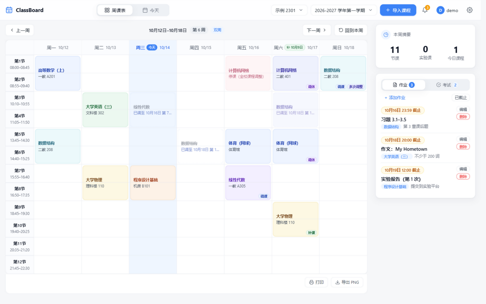
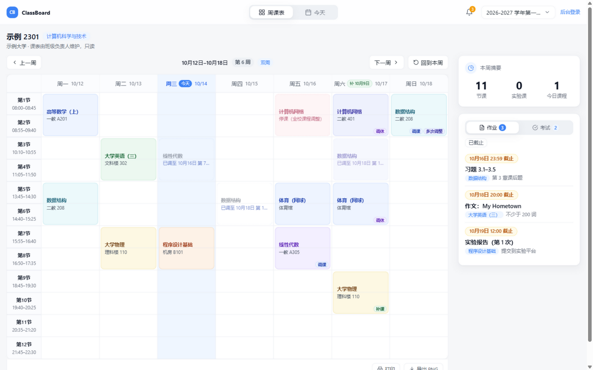
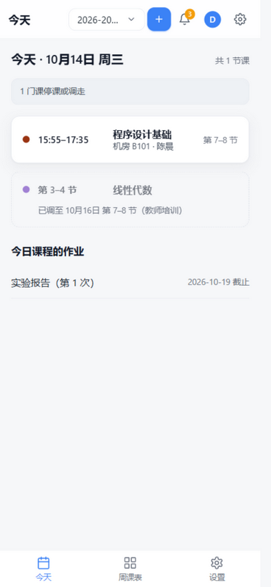

# 📚 ClassBoard · 班级课表平台

> 自托管的班级课表发布平台：班级负责人维护一份权威课表（含学期日历与单课调整），同学免登录只看；支持 PDF 课表导入、周/日双视图、班级通知、作业考试公示、变更记录与回退，跑在 NAS Docker 上，电脑手机都能用。


## ✨ 功能特性

- **班级课表发布** — 数据按班级归属（学校 + 班级名唯一），多位负责人同级共管；公开面（班级选择页 + 班级页）免登录只读，班级课表不再靠截图传播
- **PDF 课表一键导入** — 上传正方教务系统导出的课表 PDF，前端自动解析（mupdf WASM）、预览校验、确认导入，全程无需服务端处理
- **周课表双视图** — 桌面端 7 天完整视图（长按拖拽调课、冲突课程 1/3⇄2/3 动态分栏）；移动端单日视图（日期轮盘选日 + 当天课程卡片列表，松手自动回正）
- **学期日历与调整台账** — 调休（整日移课）与单课调整（停课 / 调课 / 补课）分层解析，支持「先调休再调课」等链式叠加；课表角标按类型语义色，链路可逐站查看与撤销
- **班级通知** — 负责人发布 / 置顶 / 按日期排序 / 可关联课程；顶栏铃铛即通知中心
- **作业与考试公示** — 侧栏「作业 / 考试」卡（可关联课程、截止前显示、历史查看），与课表同班共享；**可给作业 / 考试传图片与附件**：详情弹窗里图片直接内联显示（点一下放大看原图）、其余文件可下载，公开页免登录同样能看能下；上传 / 删除都进变更记录、可撤销，备份往返内容原样保留
- **变更记录与回退** — 每次写操作留痕（before/after 快照）：单条撤销、整班回退到某个时刻；冲突会列出明细不强制；管理员可看全站视图
- **导入导出 v6** — 按账号导出 / 管理员整站导出（含账号，文件内显式标注）；导入两模式（覆盖指定班级 / 作为新班级），兼容 v2–v5 旧备份翻译；天气 API Key 一律脱敏
- **账号体系** — 注册申请 → 管理员审批（通过 / 拒绝）→ 登录；角色 admin / leader，已登录设备管理
- **多学期管理** — 独立节次模板（默认 12 节含晚自习）、学期切换、数据相互隔离
- **自研 UI 体系** — 设计 Token 驱动（清新浅色极简），自研 TimePicker / DatePicker / AppSelect，无重型组件库

> **已下线**（班级平台化改造中移除）：课程提醒（含实验课提醒）、事项页、访问口令、课程模板。

## 🖼 界面预览

> 以下截图均为**示例数据**（示例大学 · 示例 2301），不含任何真实班级信息；可用 `server/scripts/seed-demo.mjs` 一键复现（见「本地开发」）。

<p align="center">
  
  
  <br>
  
</p>

## 🚀 快速开始（Docker）

```bash
# 1. 克隆仓库
git clone https://github.com/<your-name>/classboard.git
cd classboard

# 2. 构建并启动（默认端口 3000，被占用时改 CLASSBOARD_PORT）
CLASSBOARD_PORT=3000 docker compose up -d --build

# 3. 打开浏览器
# http://<你的NAS地址>:3000
```

数据持久化在 `./data/classboard.db`（挂载到容器 `/app/data`），升级容器不丢数据。

> **NAS 构建提示**：构建期网络按目标机器选一种——
> 1. **能直连 `registry.npmjs.org` 与 `github.com`**：默认即可，无需额外参数。
> 2. **需要走宿主机代理**：保留 `build.network: host`，传 `--build-arg HTTP_PROXY=http://127.0.0.1:7890 --build-arg HTTPS_PROXY=...`。
> 3. **受限网络（`github.com` / `unofficial-builds.nodejs.org` 不通，国内 NAS 常见）**：
>    ```bash
>    docker compose build \
>      --build-arg NPM_REGISTRY=https://registry.npmmirror.com \
>      --build-arg NPM_BINARY_HOST=https://registry.npmmirror.com/-/binary/better-sqlite3
>    ```
>    `better-sqlite3` 需编译原生模块，`node-gyp` 默认会联网下载 node headers；Dockerfile 已设
>    `npm_config_nodedir=/usr/local` 让它直接复用镜像自带头文件，这是内网构建成功的关键。
>    注意 `node:22-alpine` 属 unofficial build，头文件下载失败时报
>    `unofficial-builds.nodejs.org ... ETIMEDOUT`，此时务必用方案 3。

## 🗂 数据模型

数据归属根实体是**班级**（`class`，学校 + 班级名唯一；`class_member` 记录共同负责人）；每班多学期、每学期独立节次模板。课程数据采用「课程组 + 上课时间组 + 逐格子」三层结构，节次与周次**一律逐项展开存储**（`[3,4,5,6]`、`[1,2,...,16]`），不写区间、不写单双周简写；「第 3–6 节」「第 1–7 周（单周）」等文案由程序读取时派生，不写回数据库。

```
class              一个班级一行（学校 + 班级名唯一）；class_member = 共同负责人
└─ semester        一个学期一行（class.current_semester_id 记当前学期）
   └─ course       一门课一行（课程名/教师/颜色/类型/备注）
      └─ course_session  一个上课时间一组（星期 + 地点）
         └─ course_slot  一个「第几节 × 第几周」一行
```

例：数字信号处理实验（周四 9、10 节，第 11–14 周）

```
class          id=1  无锡学院  24集成2
semester       id=1  class_id=1  2026-2027-1
course          id=12  lab  数字信号处理  陈俊如  course-2
course_session  id=31  course_id=12  weekday=4  location=实验楼B103
course_slot     session_id=31  (period=9,  week=11) (period=9,  week=12) (period=9,  week=13) (period=9,  week=14)
                session_id=31  (period=10, week=11) (period=10, week=12) (period=10, week=13) (period=10, week=14)
```

学期日历（放假 / 整日移课）与单课调整（停课 / 调课 / 补课）另存为日期级覆盖层，显示时**基准课表不动**、由前端解析器分层求终到日与途经链；每次写操作落一条 `change_log`（before/after 快照），撤销与回退即生成新记录并应用逆操作。作业 / 考试的图片与附件分成两张表：`attachment` 存元数据（挂考试 XOR 作业、随其级联删除），`blob` 以 sha256 为主键存内容（**只增不删**的内容寻址池）——撤销、整班回退与备份往返都能按哈希把内容原样接回。旧的 `week_type/week_list/start_period/end_period` 已在启动时自动迁移（幂等，迁移前自动快照）。

## 🛠 本地开发

```bash
# 后端（端口 3000）
cd server && npm install && npm run dev

# 前端（端口 5173，/api 代理到 3000）
cd frontend && npm install && npm run dev
```

想直接看到带数据的界面，可以写入一份**示例数据**（只写进专门的空目录，库里有任何班级都会被拒绝，不会碰真实数据）：

```bash
cd server
CLASSBOARD_DATA_DIR=../backups/demo-seed node scripts/seed-demo.mjs --yes
CLASSBOARD_DATA_DIR=../backups/demo-seed node index.js   # 账号 demo / demo123456
```

示例数据包含：班级「示例大学 · 示例 2301」、一个学期 + 12 节模板、10 门课（含实验课与单双周）、
国庆调休与「调休 → 调课 → 再调课」链式调整、通知 / 考试 / 作业——README 的截图就是用它生成的。

## 🧪 测试

```bash
# 后端集成测试（75 项）
cd server && npm test

# 前端单元测试（149 项）
cd frontend && npm test

# 代码检查（前后端各自）
cd server && npm run lint
cd frontend && npm run lint
```

## 📖 文档

| 文档 | 内容 |
|------|------|
| [01-PRD-产品需求文档](docs/01-PRD-产品需求文档.md) | 产品定位、功能模块、交互逻辑、验收标准 |
| [02-技术设计文档](docs/02-技术设计文档.md) | 系统架构、REST 接口契约、数据库设计、Docker 部署 |
| [03-设计语言文档](docs/03-设计语言文档.md) | 设计 Token（颜色/字体/间距/圆角/阴影/断点） |
| [04-UI设计文档](docs/04-UI设计文档.md) | 页面布局线框、响应式规则、交互设计 |
| [05-UI组件参考.html](docs/05-UI组件参考.html) | 可交互组件规范参考页（浏览器直接打开） |

## 🏗 技术栈

| 层 | 技术 |
|----|------|
| 前端 | Vue 3 + Vite + Pinia + Vue Router，mupdf（WASM PDF 解析） |
| 后端 | Node.js 22 + Express 5 + better-sqlite3（SQLite WAL） |
| 部署 | 单容器 Docker（node:22-alpine 多阶段构建，非 root 运行，HEALTHCHECK） |

## 📄 许可证

本项目未指定开源许可证，保留所有权利。如需开源使用，请先联系作者。
