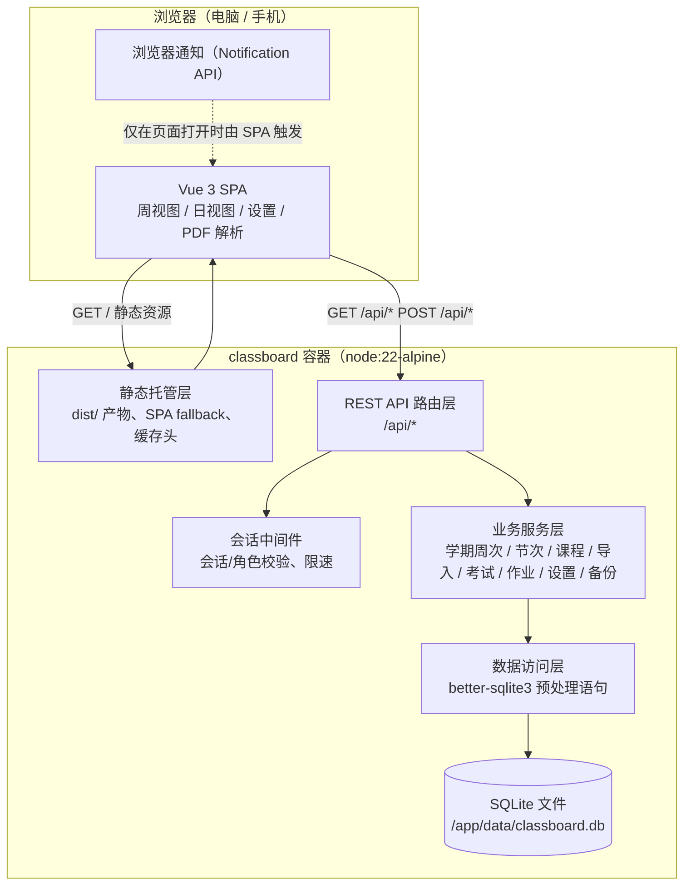
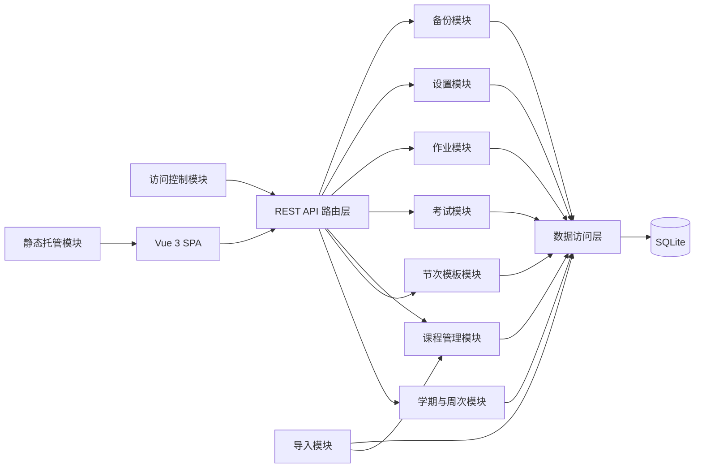
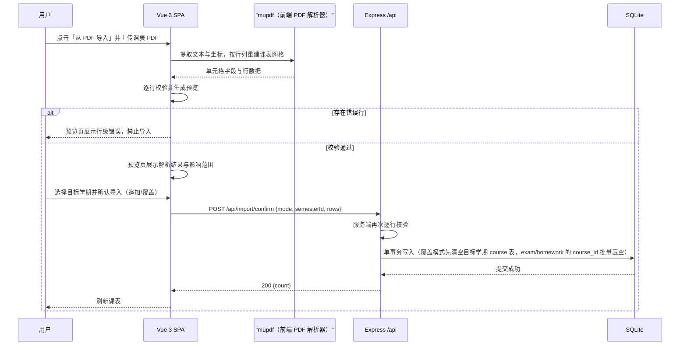

# ClassBoard 技术设计文档

| 项目 | 内容 |
|------|------|
| 产品名称 | ClassBoard（课程表 Web 应用） |
| 文档类型 | 技术设计文档（HLD 与 LLD 结合，Technical Architecture 型） |
| 文档版本 | v2.1（班级课表平台 · 含图片与附件） |
| 创建日期 | 2026-08-13 |
| 文档状态 | 已实现（v1.x 面向「家庭单用户课表工具」的版本已被班级平台化改造取代） |
| 上游文档 | 《01-PRD-产品需求文档》v2.0 |
| 部署形态 | 单容器 Docker，自托管（电脑 / NAS / 云主机均可） |
| 实现状态 | v1.1 依据 2026-08-14 代码盘点同步真实实现：后端接口/数据层已全部实现并通过 8 项集成测试；前端 62 项单测全绿；正文以 `[已实现]` / `[部分实现]` / `[未实现]` 标注各设计项的实际落地状态。v1.2 依据会话 22 UI 完善第一批同步：事项页/设置页/口令页/课程编辑删除/提醒引擎/打印导出/PWA 等前端模块落地；v1.3 依据会话 31-38 同步：Docker 部署完成、移动端双日视图、审计修复等；v1.4 依据会话 41-42 同步：移动端周课表改为单日视图 + 日期轮盘（固定 201 格序列、原生滚动映射、松手自动回正），详见《04-UI设计文档》4.14 与 3.3.1。v2.0 依据 2026-10-14 的班级平台化改造（会话 88–93）同步：数据归属由「用户」改为「班级」（`class` / `class_member`，同级共管），新增公开只读面（`/`、`/class/:id`）、班级通知、变更记录与回退（3.2.5b）、调整流水线（3.2.5a 日期覆盖层重写）与备份 v6（3.2.10、4.3.6）；提醒引擎、访问口令、课程模板、事项页与作业个人完成态已下线（正文对应条目已标注）。v2.1 依据 2026-10-14 的「作业 / 考试图片与附件」迭代（会话 94）同步：新增 `attachment`（元数据）与 `blob`（内容寻址，按 sha256 池化、只增不删）两表、附件上传 / 删除 / 公开下载接口（4.3.8）、作业与考试详情弹窗（图片内联、其余下载，公开面同构只读），撤销 / 整班回退 / 备份往返按哈希把内容接回；备份 v6 扩展 `attachments` 元数据与内嵌 `blobs`；课程下拉区分理论课与实验课。部署形态：单容器 Docker；数据落 `CLASSBOARD_DATA_DIR`，与前端同源同端口 |

## 1 设计概述

### 1.1 目标与范围

本文档描述 ClassBoard 的总体架构与详细设计：系统以单容器 Node.js 服务同时承载 REST API 与 Vue 3 构建产物（SPA），SQLite 单文件数据库落于持久化卷。v2.0（2026-10-14）起产品从「个人课表工具」转为**班级课表发布平台**：数据归属由「用户」改为「班级」（班级负责人同级共管），前台拆为**公开只读面**（班级选择页 `/` 与班级页 `/class/:id`，免登录）与**后台管理面**（`/week`、`/day`、`/settings`，负责人/管理员），支持班级通知、作业/考试公示、学期日历与单课调整台账、变更记录与回退、按账号与整站导出及两模式导入。

设计范围包括：系统架构与技术选型、服务端与前端模块划分、REST 接口契约、数据库设计、非功能设计、Docker 部署设计与错误处理；支持多学期并存，每学期的课程/考试/作业/节次模板完全独立。设计边界内不做以下事项：云端同步与服务端推送（通知为站内公示）、移动端原生 App、复制上学期数据（学期数据相互独立，需手动维护）、跨班级数据共享、定时自动备份。课程提醒、访问口令与课程模板为已下线能力（会话 88–89 移除，正文相应条目已标注）。

### 1.2 上游需求追溯

| PRD 模块（v2.0） | 本文档对应设计 |
|----------|----------------|
| 5.2 公开面（班级选择 / 班级页） | 3.3 前端模块、4.2 接口清单 54、6.2 安全（白名单字段） |
| 5.3 账号与班级（注册审批 / 共管） | 3.2.1 权限与归属、4.2 接口清单 53+、5.2 class / class_member / user 表 |
| 5.4 学期与节次 | 3.2.3 学期与周次模块、4.3.1 接口、5.2 semester / period_template 表 |
| 5.5 课表（周/日视图） | 2.4 数据流、3.3 前端模块、4.3.2 查询接口 |
| 5.6 课表导入 | 2.4 数据流、3.2.6 导入模块、3.3.3 PDF 解析器与手动录入、4.3.5 导入接口、5.3 事务一致性 |
| 5.7 学期日历 / 5.8 单课调整 | 3.2.5a 日期覆盖层（调整流水线）、4.2 接口 41–46、5.2 semester_day_rule / course_adjustment 表 |
| 5.9 通知 | 4.2 接口 51、5.2 notice 表 |
| 5.10 作业与考试公示 | 3.2.7 考试模块、3.2.8 作业模块、4.3.3 / 4.3.4 接口、5.2 exam / homework 表 |
| 5.11 变更记录与回退 | 3.2.5b 变更记录与回退、4.2 接口 47–50、5.2 change_log 表 |
| 5.12 导入导出 | 3.2.10 备份模块、4.3.6 备份接口、6.3 备份恢复 |
| 5.13 设置 | 3.3.1 前端模块、4.3.7 设置接口、5.2 user_setting 表 |
| 6 非功能（性能/部署/安全） | 6.1 性能设计、6.2 安全、7 Docker 部署设计 |
| 9 验收标准 1-6 | 7 部署设计、4.3 接口、5 数据设计对应验证点 |

### 1.3 关键假设与术语

| 假设 | 说明 |
|------|------|
| 多学期并存 | 学期可增删，每学期拥有独立课程/考试/作业/节次模板；当前学期由 `class.current_semester_id` 记录（会话 88 起班级持有，此前在 setting 表）；学期数据按 class_id / semester_id 隔离；不支持复制上学期，手动切换当前学期，导入时选择目标学期 `[Data-backed]` |
| 多负责人共管 | 同一班级可有多位负责人（`class_member`，同级无 owner），任一人可管理该班全部数据；公开面免登录只读 `[Data-backed]`（会话 88） |
| 家庭单时区 | 家庭场景时区固定，时间字段一律存本地时间字符串（如 `08:00`、`2026-09-01 09:00`），不做 UTC 转换 `[Expert judgment]` |
| 低并发 | 家庭场景，预期并发 1-2 个浏览器标签页 `[Hypothesis]`，设计上不做连接池与集群 |
| 课程规模 | 单学期课程 ≤ 200 门、考试作业 ≤ 500 条 `[Hypothesis]`，支撑 SQLite 与单请求聚合的设计 |

| 术语 | 定义 |
|------|------|
| 班级 | 数据归属单元（`class`：学校 + 班级名唯一），下挂学期与成员 |
| 负责人 | 班级成员（`class_member`），可管理所辖班级全部数据；管理员（admin）可管理全站 |
| 公开面 / 后台面 | 路由分区：公开面（`/`、`/class/:id`，免登录只读）与后台面（`/week`、`/day`、`/settings`，负责人/管理员）；公开面不返回用户/设置/密钥 |
| 节次 | 课表的时间单元，如「第 1 节」，其起止时间由节次时间模板定义 |
| 周序号 | 以学期起始日（对齐每周起始日）为基准计算出的第 N 周，从 1 开始 |
| 单双周 | 以周序号奇偶区分的周类型；单周课程只在奇数周显示，双周同理 |
| 全部周课程 | 每个教学周都上的课程（周次为 1..N 全量逐项记录） |
| 自定义周 | 显式列举课程出现周序号（存储层统一为逐周数组，不再区分规则类型） |
| 调整流水线 | 基准发生 → 调休闭包 → 单课调整按来源发生匹配 → 终到日 + 途经链（3.2.5a） |
| 变更记录 | 每次写操作落一条 `change_log`（before/after 快照），撤销 = 生成新记录并应用逆操作（3.2.5b） |
| 访问口令 | `[已下线]` 可选门禁口令；会话 89（P2）起移除（改为账号登录 + 角色） |
| 站内提醒 | `[已下线]` 应用内铃铛提醒；会话 89 起铃铛改为班级通知中心 |
| 当前学期 | 当前操作的学期，由 `class.current_semester_id` 记录，context 接口下发 |
| 持久化卷 | 容器内挂载到宿主机目录的存储，容器重建后数据保留 |

## 2 系统架构

### 2.1 架构风格

系统采用「单容器分层单体」：一个 Node.js 进程内包含静态托管、REST API 路由、业务服务与数据访问四层，前端 SPA 构建产物由同一进程托管，与 `/api` 同源同端口。选择该风格的理由：单用户低并发场景（1.3）不需要独立网关与横向扩展；同源部署消除跨域配置与 Cookie 兼容问题；单容器形态对 NAS 环境是唯一可验证的部署单元（对应 PRD 验收标准 6 的「容器启动成功、重启不丢数据」）；SQLite 单文件数据库与服务进程同生命周期，无外部依赖，家庭数据不出本机的诉求（PRD 需求背景）在物理结构上得到保证。

### 2.2 架构图



图 2-1 ClassBoard 单容器分层架构

图 2-1 说明：浏览器中的 Vue 3 SPA 通过两个入口访问容器：静态资源请求（`GET /` 及其子路径）由静态托管层返回 `dist/` 构建产物，其中带内容哈希的资产文件带一年缓存头，`index.html` 不缓存且对非 `/api` 路径做 SPA fallback（前端路由由 Vue Router history 模式接管）；数据请求统一走 `/api/*`，先经会话中间件（校验会话 Cookie、角色与账号状态），再进入 REST 路由层分发到对应业务服务；班级数据再经 `class_member` 归属校验。公开面 `/api/public/*` 不经会话中间件（只读字段白名单）。业务服务层各模块只与数据访问层交互，数据访问层通过 better-sqlite3 的参数化预处理语句读写 SQLite 单文件，数据库文件位于持久化卷 `/app/data`，与容器生命周期解耦。浏览器通知不经过网络层：站内通知为班级公示数据（notice），经公开接口下发；个人提醒引擎已下线（会话 89）。

### 2.3 组件职责与边界

| 组件 | 拥有 | 不拥有 | 依赖 |
|------|------|--------|------|
| 静态托管层 | dist/ 产物分发、SPA fallback、静态缓存头 | 任何业务数据 | 无 |
| 会话与账号中间件 | 会话签发与校验、角色（admin/leader）与状态（active）校验、登录限速 | 业务逻辑 | user 表、内存会话表 |
| REST API 路由层 | 路径到服务的映射、请求解析、统一错误信封 | 业务规则 | 业务服务层 |
| 业务服务层 | 多学期管理（含当前学期标记）与周次计算、课程/考试/作业/设置/导入/备份的业务规则 | HTTP 细节、SQL 拼接 | 数据访问层 |
| 数据访问层 | 建表迁移、预处理语句、事务封装 | 业务规则 | SQLite 文件 |
| Vue 3 SPA | 视图渲染、路由、状态管理、PDF 课表解析、提醒调度 | 数据持久化 | 上述 API |

### 2.4 关键数据流

首次访问：SPA 加载后请求 `GET /api/context`，一次请求带回学期列表、当前学期 id、当前学期的节次模板与设置；随后按设备断点跳转默认视图（手机竖屏进日视图、桌面进周视图，PRD 目标 2），并请求 `GET /api/schedule?date=今天` 得到本周聚合数据用于渲染。该聚合接口在服务端完成周序号计算、单双周/自定义周可见性过滤、节次时间解析与假期判定，前端只做展示，保证「课表渲染 ≤ 300ms」的目标（对应 PRD 性能指标）。

口令门禁的旧数据流（`/api/access/verify` 公开、401 后弹口令页）已随会话 89 下线。现数据流：公开面 `/api/public/*` 无需会话；后台接口无有效会话时返回 401 AUTH_REQUIRED（SPA 跳登录页），未审核账号（pending/rejected）仅可访问登录与状态接口。

课程导入数据流：前端使用 mupdf（WASM 版）在浏览器内解析课表 PDF 并预览（PRD 5.5 明确前端解析），确认时选择目标学期，把规范化后的行数据连同目标学期 id 提交 `POST /api/import/confirm`，服务端在单事务内完成校验与写入（覆盖模式仅清空目标学期的 course 表数据，该学期已有的 exam/homework 记录保留、course_id 置空），任一错误行导致整体回滚。该流程的详细交互见 4.3.5 的时序图。

### 2.5 技术选型与理由

| 选型 | 理由 | 服务的需求 |
|------|------|------------|
| node:22-alpine 单容器 | 与前端构建产物同进程托管，镜像约 50-70 MB，Alpine 在 NAS 常见（含 ARM）上镜像拉取快；better-sqlite3@13 要求 Node≥22 | PRD 6 部署（x86/ARM、NAS） |
| Express | Node 生态事实标准路由框架，中间件机制适配访问控制与静态托管的组合 | 4 接口设计、3.2.2 |
| better-sqlite3 | 同步 API 使单用户业务逻辑无回调嵌套；自带预处理语句防注入；零外部服务，数据即本地文件 | PRD 需求背景（数据不出本机）、6.1 性能 |
| SQLite WAL 模式 | 读写不互斥，配合低并发场景；单文件 `.db` 便于卷级备份 | 6.1、6.3 |
| Vue 3 + Vite | 组件化与响应式满足周/日视图高频重渲染；Vite 产出带哈希的小体积静态包，构建配置简单 | PRD 目标 2、6 性能 |
| Pinia + Vue Router | 状态管理与路由的标准配套；路由级代码分割控制首屏体积 | 3.3.1 |
| mupdf（WASM） | 在浏览器内提取 PDF 文本与坐标元数据，按表格线/坐标重建课表网格；无需服务端 PDF 依赖；`[实测]` 正方课表 PDF 的 STSong-Light 字体无 ToUnicode 映射（GBK 编码），pdfjs-dist 的 getTextContent 提取为空，而 mupdf 可正确解码，故弃用 pdfjs-dist 改用 mupdf | PRD 5.5（前端解析）、6 性能 |
| Node 内置 crypto（scrypt） | 口令哈希与校验全部用内置模块完成，不引入额外原生依赖，避免 Alpine 编译面 | 6.2 安全 |
| compression 中间件 | 对静态资产启用 gzip，压缩率约 60-70%，服务首屏 ≤ 2s 目标 | 6.1 性能 |
| 自研轻量 UI 组件 + CSS 变量 | 不引入 Element Plus 等重型组件库，包体更小；统一使用设计语言 v2.0 的 CSS 变量 token，便于整体风格维护 | 6 性能、PRD 5.1-11 |

以上库的版本号在实现时锁定并写入 package-lock.json；本设计不承诺具体版本，除既定决策外标注 `[To be confirmed]`。

## 3 模块设计

### 3.1 模块划分与依赖



图 3-1 服务端模块依赖图

图 3-1 说明：所有业务模块只依赖数据访问层，依赖方向单向无环。REST API 路由层是唯一 HTTP 入口，负责将请求分发给对应业务模块；访问控制模块以中间件形式挂在路由层之前，不直接依赖任何业务模块。导入模块复用课程管理模块的写入能力（同一校验与写入函数），保证「手动编辑」与「导入」两条路径行为一致。静态托管模块与前端 SPA 之间是产物文件关系，不构成运行时调用。

### 3.2 服务端模块

以下每个模块的责任均可用一句话描述，超出该句范围的职责划分到其他模块。

**3.2.1 静态托管模块**

| 项 | 内容 |
|----|------|
| 责任 | 分发 `dist/` 静态产物并对非 `/api` 路径做 SPA fallback |
| 输入 | HTTP GET 请求 |
| 输出 | 静态文件响应（带缓存头）或 `index.html` |
| 依赖 | 前端构建产物 |
| 边界 | 不处理任何数据请求，不写日志业务内容 |

**3.2.2 账号与访问控制模块**（v2.0：由「口令门禁」改造为账号体系）

| 项 | 内容 |
|----|------|
| 责任 | 注册申请、登录/登出、会话签发与校验、待审核拦截（pending/rejected）、设备会话管理；管理员审批与用户管理 |
| 输入 | Cookie（`classboard_session`）、`/api/access/*` 与 `/api/approvals/*`、`/api/users/*` 请求体 |
| 输出 | 放行或 401/403/429 响应；签发/销毁会话；审批结果 |
| 依赖 | user 表（角色 admin/leader、状态 pending/active/rejected、口令哈希 saltHex:hashHex）、内存会话表 |
| 边界 | 不参与班级数据校验（归属由 4.2 的成员助手判定）；口令哈希不提供找回（管理员可重置）；可选「开放注册」总开关（`PUT /api/users/signup`）；访问口令页已下线（会话 89） |

**3.2.3 学期与周次模块**

| 项 | 内容 |
|----|------|
| 责任 | 管理多个学期（增删改查）、维护当前学期标记、计算任意日期在指定学期内的周序号、单双周与假期状态 |
| 输入 | 学期管理请求（增删改查、设置当前学期）、任意日期 |
| 输出 | 学期对象列表、当前学期 id、周序号、isOddWeek、isHoliday |
| 依赖 | semester 表、setting 表（当前学期标记） |
| 边界 | 不感知课程与节次；删除学期需级联处理其课程/考试/作业/节次模板数据（删除前二次确认，级联删除该学期全部数据）；当前学期标记由 `class.current_semester_id` 持有（v2.0 起） |

周序号算法（供 4.3.2 聚合接口调用，在指定学期内计算）：设该学期起始日为 S、每周起始日对齐偏移为 `offset = (date.getDay() - weekStartDay + 7) % 7`，则 `weekNumber = floor((date - S + offset) / 7天) + 1`；`date < S` 或 `date > 该学期结束日` 时返回 isHoliday=true，周序号为空。

**3.2.4 节次模板模块**

| 项 | 内容 |
|----|------|
| 责任 | 每个学期各自维护节次行（可增删改），行数不固定，按 period_index 排序 |
| 输入 | 节次行的增删改请求（携带 semesterId） |
| 输出 | 节次列表（按 period_index 升序） |
| 依赖 | period_template 表 |
| 边界 | 不计算课程可见性；删除行后对剩余行重新排序 period_index，同学期内不可重复 |

**3.2.5 课程管理模块**

| 项 | 内容 |
|----|------|
| 责任 | 维护课程及其周内安排（星期、起止节次、周规则）；所有课程归属某学期（semester_id），周可见性计算基于该学期周次设置；手动录入课程复用本模块创建能力，不经过导入事务 |
| 输入 | 课程增删改查请求（携带 semesterId）、导入确认行数据、手动录入请求（同创建接口） |
| 输出 | 课程对象；周可见性判定结果（供聚合接口使用） |
| 依赖 | course 表；节次模板（时间解析） |
| 边界 | 不拦截时间重叠（PRD 5.2 明确后导入者错位显示，冲突只在详情标注，不做拦截） |

周可见性规则：设当前周序号为 W，某上课时间是否出现 = 其 course_slot 中存在 week = W 的行（一条索引查询）。学期周号由 `lib/weekspan.js`（服务端）与 `utils/week.ts`（前端）用同一套公式计算：以 weekStartDay 为界锚定周起点，周序号 = 目标周起始日与学期首周起始日相差的周数 + 1。返回 0 表示未开学（早于起始日）、null 表示学期已结束（假期）；`/api/schedule` 另以 `isBeforeSemester` 字段让前端区分二者，且两侧公式由 `week.spec.ts` 的一致性用例锁死。

**日期覆盖层（调休与单课调整，会话 85/86/88）**：基准课表（course/course_session/course_slot）语义不变，调休与单课调整是叠加在其上的**日期级覆盖层**，由 `GET /api/calendar`（学期日历：放假 / 整日移课）与 `GET /api/adjustments`（停课 / 调课 / 补课）两条数据集提供，服务端只负责存储与校验，**不做解析**。解析在前端 `utils/calendar.ts` 的纯函数 `resolveDay(date, ctx)` 里统一完成（手机端 ±150 天日期条无法逐日请求服务端，故解析必须在前端）：

会话 90（P3）把「调休」与「调课」合成**一条流水线**，因为两者叠加时（先调休再调课、先调课再调休）旧实现会算错（课同时出现在两处，或调休把调课结果漏掉）。现在的分层：

1. **枚举基准发生**：本学期课程的时间组 × 周次 → 「那一天的那一节次」（`dateOfWeekday` 逐周铺开）；`holiday` 当天不产生发生。**不假设课表每周重复**——跳周课程按周号自然命中。
2. **调休闭包**：基准日若被整日移课，沿 `date → to_date` 一路跟到底（`shiftPath` 带 visited 环保护）；A→B→C 的中间站也要留「经此」标记。
3. **单课调整游走**：调整按 `id` 升序（创建顺序）逐条尝试，**按「当前所在日期 + 节次集合」匹配**（`matchesHere`；旧记录没有节次时才退回按星期匹配）。每次移动后若新落点本身又是调休源日，继续沿调休链走——于是「先调课、后调休」也成立。每条记录最多命中一次，来回最多 8 轮直到稳定（同一门课同一天只有一个块）。
4. **出账**：块**只出现在终到日**，带 `source: 'base' | 'moved' | 'extra' | 'shifted'`、`originDate`（基准日）、`fromDate / fromPeriods`（来源发生）、`adjustmentId`、`chain`（完整调整链 `AdjustHop[]`）；链上 ≥2 站时 `multiAdjusted = true`（显示「多次调整」角标）。基准日与中间站在原位置留淡显标记（`DayMarker.kind = 'cancel' | 'move' | 'shift' | 'via'`，各站**用它自己当时的节次**，一律指向终到日）。整日调休的标记用 `ruleId` 指回日历规则——规则要在台账里清除，单课调整才可以逐站撤销。
5. **显示面只有一套**：周网格按「日期列」渲染，日头 `dayLabel`（「假期」/「调休」/「补 9月29日」）；手机日卡、今天页、侧栏、台账全部读同一份 `resolveDay` 结果；冲突检测与统计只计入课程块，原位置标记不参与。
6. **写入期校验**：同一学期的移课**目标日唯一**（同一天不能承接两天的课，多源 → 400 并指名冲突的那条）且**无环**（`from → to` 链若绕回源日 → 400，避免展示层出现死循环）；`clear` 只按日期清，不动其他日期的规则。

> 早期（会话 85 首发）的调休曾是「10/10 按周四课表」的**周几模型**，它隐含「课表每周重复」，对跳周实验课会取错目标日那一周的课；会话 86 依据用户反馈改为上述「某日 → 某日 整日移课」，旧规则在服务启动时自动无损迁移（源日 = 该周内对应星期的那一天）。

**3.2.5b 变更记录与回退（会话 91）**

每一次写操作都落一条 `change_log`（谁 / 什么时候 / 动了什么 / before → after）。记录里存的是**当时的快照**，不是描述性 diff：

| 记录类型 | 存什么 | 为什么 |
|----|----|----|
| 实体级（课程 / 学期 / 节次 / 考试 / 作业 / 调整 / 通知 / 日历 / 班级资料 / 成员） | 该对象的**完整快照**（课程含上课时间、格子、它的调课记录，以及引用它的考试 / 作业 id；学期含整棵子树） | 单条撤销要能原样放回去：删课程会级联删掉时间组/格子/调课，置空考试与作业的关联，快照不够就还原不完整 |
| 整班级（删学期 / 删节次 / 导入 / 删班 / 日历 / 建班 / 成员退出到最后一人） | **整班状态快照**（班级行 + 成员 + 学期 + 节次 + 课程 + 考试 + 作业 + 日历 + 调整 + 通知） | 这些操作牵连面太大，逐条逆操作不如整班还原 |

回退两条路径（都**只追加记录、不截断历史**）：

1. **单条撤销** `POST /api/changes/:id/revert` —— 实体级逆操作（`lib/restore.js` 的 `restoreEntity`）：before 有值就按显式 id 放回去，before 为 null 就删掉。守卫：撤销「唯一负责人加入」会被拒（否则班级没人管）、唯一键冲突给可读提示、删课程后按 `refs` 把考试 / 作业的关联接回去。
   **冲突判定看现状、不看日志**：之后的记录里，谁改的现在还「算数」（`entitySnapshot` 与记录的 after 子集相等）才报 409 —— 这样「先撤销后一步、再往回撤上一步」不会被自己上一步的撤销记录挡住。
2. **整班回退** `POST /api/classes/:id/rollback` —— 目标状态 = **离它最近的整班快照 + 其后实体级记录按 id 顺序重放**（`restoreStateAt`）。只有整班级操作才存整班快照，所以不能直接拿某条记录的 after 当整班状态。若这条记录之前**还没有任何整班快照**（老库的早期记录），直接 400 报明「回退不到这么早」，绝不用「从空班重放」的方式把课表抹掉。回退后写一条 `rollback` 记录（`revert_of` 指向目标记录）。

**3.2.6 导入模块**

| 项 | 内容 |
|----|------|
| 责任 | 接收前端解析后的行数据，服务端再校验并写入指定学期，按追加/覆盖模式事务写入；覆盖模式仅清空目标学期的 course 表数据，该学期已有的 exam/homework 记录保留、course_id 置空（ON DELETE SET NULL 语义，批量置空） |
| 输入 | `POST /api/import/confirm` 的 rows、mode 与 semesterId |
| 输出 | 导入成功行数或行级错误明细 |
| 依赖 | 课程管理模块、course 表 |
| 边界 | 不做 PDF 解析（PRD 规定前端解析）；服务端仅接收规范化行数据，不持有解析器 |

**3.2.7 考试模块**

| 项 | 内容 |
|----|------|
| 责任 | 维护考试记录（归属某学期，可关联课程，可按时间范围查询） |
| 输入 | 考试增删改查请求（携带 semesterId） |
| 输出 | 考试对象列表 |
| 依赖 | exam 表；course 表（外键，删除课程时置空） |
| 边界 | 不参与周次计算，按绝对日期时间排序展示 |

**3.2.8 作业模块**

| 项 | 内容 |
|----|------|
| 责任 | 维护作业记录（归属某学期）与完成状态切换 |
| 输入 | 作业增删改查请求（携带 semesterId）、完成状态切换请求 |
| 输出 | 作业对象列表 |
| 依赖 | homework 表；course 表（外键，删除课程时置空） |
| 边界 | 不发送任何通知，提醒只发生在「今天」查询结果之上 |

**3.2.9 设置模块**

| 项 | 内容 |
|----|------|
| 责任 | 读写单双周过滤、天气等非业务设置（三组提醒键已随 P2 下线） |
| 输入 | 设置读写请求 |
| 输出 | 设置对象（weather.apiKey 读取时掩码） |
| 依赖 | user_setting 表 |
| 边界 | 账号口令哈希由账号模块独占读写（user 表），设置模块不接触 |

**3.2.10 备份模块**

| 项 | 内容 |
|----|------|
| 责任 | 按账号导出（该用户名下全部班级）/ 管理员整站导出 / JSON 导入恢复（两模式） |
| 输入 | 导出请求（账号或整站）、恢复上传文件 + 目标班级参数（覆盖 `classId` 或新建 `school` + `name`） |
| 输出 | JSON 文件流；恢复结果统计（`restored`：班级/学期/课程/考试/作业/日历/调整/通知计数） |
| 依赖 | 全部业务模块的表 |
| 边界 | 不做定时任务；恢复前自动生成一份数据库一致性快照作安全网；整站导出含全部用户（含口令哈希），文件内以 `includesPasswordHashes: true` 与 warning 文案显式标注；天气 API Key 一律脱敏（导入时保留本地已有 Key） |

### 3.3 前端模块

**3.3.1 应用骨架与状态管理** `[已实现]`：Vue Router 分区路由——公开面 `/`（班级选择面板，按学校/班级名搜索）与 `/class/:id`（只读班级页）；后台 `/login`（登录 + 注册申请 + 待审核提示）、`/week`（周视图）、`/day`（今天）、`/settings`（设置）；路由级动态导入使各视图按需加载，路由 meta 守卫（无需登录的公开面 / 需登录的后台面）。状态管理为**单一 `scheduleStore`**（`stores/schedule.ts`）：持有班级列表/当前班级/学期列表/当前学期/节次/课程/周上下文、考试/作业全量列表与设置，并带 `readonly` 只读模式（公开面复用同一套组件与解析器，写操作入口隐藏）；后台写操作由 store 调用班级归属下的接口。`scheduleStore` 持有聚合接口返回的周数据作为渲染唯一来源，避免多接口拼装导致的时序不一致。视图按当前学期拉取数据，设置页含班级/学期/节次/日历/变更记录/显示/天气/数据/账号/审批/用户管理页签。新课程颜色分配在前端 `scheduleStore` 完成：按录入顺序从 8 色预设中轮询，课程名（name）相同的复用已有颜色，后端仅存色值 `[已实现]`；课程颜色手动修改（编辑器 8 色色卡）`[已实现]`。`index.html` 注册 Web App Manifest（含 192/512 图标）`[已实现]`（`public/manifest.webmanifest` + PIL 生成 PNG 图标）。周视图打印与导出 PNG `[已实现]`（`@media print` A4 横向打印样式 + `utils/exportPng.ts` DOM→canvas 2x 高清导出）。

**3.3.2 提醒引擎** `[已下线]`：会话 89（P2）移除——删除 `utils/reminder.ts`、设置页提醒面板与 `reminder` / `lab_reminder` / `homework_reminder` 三组设置键（备份导入也不再复活这些键）；顶栏铃铛改为**班级通知中心**（角标 = 通知总数）。下线前的实现为页面打开时每 30s 基于当日课程与提醒设置触发浏览器 Notification；不再保留，也不再随备份导出入。

**3.3.3 PDF 解析器与手动录入**：使用 mupdf（WASM 版，浏览器内运行）完成「上传 PDF → 提取文本与坐标 → 按行列重建课表网格 → 解析单元格字段 → 行级校验」流程，与后端共享同一套字段约束定义（名称 1-50 字、星期 1-7、节次在目标学期模板范围内（默认 1-12）且结束≥开始等）。选型说明 `[Data-backed]`：样本《严子辰(2026-2027-1)课表.pdf》正文使用 STSong-Light 字体且无 ToUnicode 映射（字符以 GBK 编码直接绘制），pdfjs-dist 的 getTextContent 对该文件返回空文本，实测 mupdf 可完整解码，故解析库定为 mupdf（懒加载，独立 chunk 约 10 MB，仅「从 PDF 导入」时加载）。PDF 解析规则基于该真实样本解析得出：样表 3 页 A4 横向（842×595pt），第 1 页为课表主体，表头为「时间段 | 节次 | 星期一~星期日」，行分组为上午(1-4 节)/下午(5-8 节)/晚上(9-10 节)共 10 节；单元格字段以 `/` 分隔、`:` 键值，格式为「课程名（可带 ▲/●）/ (开始-结束节)周次规则/场地:xx/教师:xx/教学班:xx/教学班组成:xx/考核方式:xx/选课备注:/课程学时组成:讲课:N,实验:M/周学时:N/总学时:N/学分:N」；周次规则形式 `1-16周`、`1-15周(单)`、`1-8周,10-16周(双)`、`1-10周,12周,15周`、`6-13周`，解析时展开为逐周序号数组 `weeks`（如 `1-15周(单)` → `[1,3,5,...,15]`）；课程类型判定（`[Data-backed]` 开发确认，会话 9）：PDF 导入课程**一律 type='course'**（教务 PDF 仅提示课程含实验学时，不代表该节课是实验课），实验学时信息保留进备注，实验课由用户手动录入；跨节次单元格按 (开始-结束节) 展开。第 2 页「实践课程：」「其他课程：」汇总行作为参考提示展示，不强制解析 `[Expert judgment]`。顶栏「导入课程」为下拉入口，含「从 PDF 导入」与「手动录入」两项：手动录入直接打开课程编辑弹窗（含课程类型选择），保存即调用 `POST /api/courses` 创建课程，不经过 PDF 解析与预览流程；两者互相独立，均写入当前/所选学期。

**3.3.4 主题与断点**：主题固定为清新浅色（`color-scheme: light`，本期无暗色模式，见设计语言文档 v2.2 第 11 节）；断点工具返回设备类别供默认视图跳转与周课表布局切换使用（手机端为单日视图 + 日期轮盘，桌面/平板为 7 天网格，PRD 5.2）。

## 4 接口设计

### 4.1 通用约定

**4.1.1 基础约定**：所有接口位于 `/api` 前缀之下，请求与响应均为 `application/json`（下载类接口除外，见各契约）；日期时间为本地时间字符串；会话 Cookie 名为 `classboard_session`（HttpOnly、SameSite=Lax、Path=/）。公开面 `/api/public/*` 不挂会话（只读，字段白名单：绝不返回用户、设置、密钥）；后台接口要求有效会话（未登录 401 AUTH_REQUIRED），班级数据再经归属校验（`class_member` 判定，非本班成员按 403 / 404 处理）。账号体系为注册 → 管理员审批（pending/active/rejected）→ 登录；访问口令已下线（会话 89）。

**4.1.2 统一错误信封**：所有失败响应体为

```json
{ "code": "VALIDATION_ERROR", "message": "星期取值无效", "details": [ { "field": "weekday", "message": "取值必须为 1-7" } ] }
```

HTTP 状态码与 code 的映射：

| HTTP | code | 触发条件 |
|------|------|----------|
| 400 | VALIDATION_ERROR | 字段校验失败，details 标注字段或行号 |
| 400 | BAD_FILE | 备份文件格式不符 |
| 401 | AUTH_REQUIRED | 未登录或会话失效 |
| 403 | ACCESS_DENIED | 非本班成员 / 非管理员访问受限资源 |
| 404 | NOT_FOUND | 资源不存在 |
| 409 | CHANGE_CONFLICT / 同名班级 | 撤销冲突（列出明细）/ 同名加入需确认（带可加入标记） |
| 413 | FILE_TOO_LARGE | 上传超过大小限制 |
| 429 | RATE_LIMITED | 登录尝试超频 |
| 500 | INTERNAL_ERROR | 未预期异常（不输出堆栈） |

**4.1.3 对象 Schema**（后续契约直接引用）

| 对象 | 字段 |
|------|------|
| Semester | `id:number`、`name:string(1-50)`、`startDate:string(YYYY-MM-DD)`、`endDate:string(YYYY-MM-DD)`、`weekStartDay:1|7` |
| Period | `id:number`、`semesterId:number`、`index:number(≥1)`、`startTime:string(HH:mm)`、`endTime:string(HH:mm)` |
| Course | `id:number`、`semesterId:number`、`type:'course'\|'lab'`、`name:string(1-50)`、`teacher:string(0-30)`、`location:string(0-50)`、`color:string（8 色预设色名之一）`、`remark:string(0-200)`、`sessions: CourseSession[]`（空数组=无固定时间课程） |
| CourseSession | `id?:number`、`weekday:1-7`、`location:string(0-50)`、`periods:number[]`（逐项节次）、`weeks:number[]`（逐周周次） |
| Exam | `id:number`、`semesterId:number`、`courseId:number\|null`、`name:string(1-50)`、`datetime:string(YYYY-MM-DDTHH:mm)`、`location:string(0-50)`、`remark:string(0-200)`、`attachments:Attachment[]` |
| Homework | `id:number`、`semesterId:number`、`courseId:number\|null`、`name:string(1-50)`、`dueAt:string(YYYY-MM-DDTHH:mm)`、`remark:string(0-200)`、`attachments:Attachment[]`（个人完成态 `done` 随 P2 改为班级公示，已删除） |
| Attachment | `id:number`、`examId:number\|null`（与 homeworkId 二选一）、`homeworkId:number\|null`、`name:string(1-120)`、`mime:string`、`size:number`、`sha256:string(64 hex)`、`kind:'image'\|'file'`（由 mime 派生：png/jpeg/gif/webp/bmp 内联，其余下载）、`createdAt:string` |
| Class | `id:number`、`school:string(1-30)`、`name:string(1-30)`（UNIQUE(school, name)）、`major:string`、`city:string`、`currentSemesterId:number\|null` |
| Notice | `id:number`、`classId:number`、`date:string(YYYY-MM-DD)`、`title:string(1-100)`、`body:string`、`courseId:number\|null`、`pinned:boolean`、`authorId:number` |
| Settings | `showOddEvenFilter:boolean`、`weather:{ provider, apiKey, city? }`、`site:{ footerText, icp, policeIcp, showVisits }`（提醒三组键随 P2 下线；天气 / 站点写入仅 admin，API Key 读取时掩码；`site` 为公开信息） |
| ImportRow | `name:string(1-50)`、`type?:'lab'`、`teacher?`、`location?`、`remark?`、`color?:string`、`sessions:[{ weekday:1-7, location, periods:number[], weeks:number[] }]`（PDF 解析结果一律单个 session） |

注：Period 行数不固定，默认 12 节（含晚自习），时间见 4.3.1；作业/考试为班级公示数据，无个人完成态（会话 89 起）。

### 4.2 接口清单

| # | 方法与路径 | 用途 |
|---|-----------|------|
| 1 | POST /api/access/login | 登录（账号 + 口令，签发会话 Cookie `classboard_session`） |
| 2 | POST /api/access/logout | 退出登录（销毁当前会话） |
| 3 | POST /api/access/register | 注册申请（学校/专业/意向班级等资料；落 `pending` 待审批） |
| 4 | GET /api/access/me | 当前登录用户（含角色与审批状态）；另有 `GET /api/access/signup-enabled`（是否开放注册）、`GET/DELETE /api/access/sessions[/:id]`（会话列表与下线） |
| 5 | GET /api/context | 应用启动聚合（学期列表/当前学期/节次/设置） |
| 6 | GET /api/schedule?date= | 指定日期所在周聚合数据（周/日视图与提醒共用） |
| 7 | GET /api/semesters | 学期列表 |
| 8 | POST /api/semesters | 创建学期 |
| 9 | PUT /api/semesters/:id | 更新学期 |
| 10 | DELETE /api/semesters/:id | 删除学期（级联清理该学期全部数据） |
| 11 | PUT /api/semesters/current | 设置当前学期（body `{id}`） |
| 12 | GET /api/periods?semesterId= | 读指定学期节次模板 |
| 13 | POST /api/periods | 新增节次行（body 含 semesterId/startTime/endTime） |
| 14 | PUT /api/periods/:id | 修改节次行起止时间 |
| 15 | DELETE /api/periods/:id | 删除节次行（剩余行重新排序） |
| 16 | GET /api/courses?semesterId=&type= | 课程列表（按学期与类型过滤） |
| 17 | POST /api/courses | 新增课程（手动录入与周视图空白格新增共用） |
| 18 | GET /api/courses/:id | 课程详情 |
| 19 | PUT /api/courses/:id | 更新课程 |
| 20 | DELETE /api/courses/:id | 删除课程 |
| 21 | GET /api/exams?semesterId= | 考试列表（按时间倒序，按学期过滤） |
| 22 | POST /api/exams | 新增考试 |
| 23 | PUT /api/exams/:id | 更新考试 |
| 24 | DELETE /api/exams/:id | 删除考试 |
| 25 | GET /api/homework?semesterId=&scope= | 作业列表（按学期过滤；`scope=upcoming` 只取未截止） |
| 26 | POST /api/homework | 新增作业 |
| 27 | PUT /api/homework/:id | 更新作业 |
| 28 | — | （P2 起作业为班级公示、无个人完成态，原 `PATCH /api/homework/:id/done` 已删除） |
| 29 | DELETE /api/homework/:id | 删除作业 |
| 30 | POST /api/import/confirm | 确认导入（追加/覆盖，指定目标学期） |
| 31 | GET /api/backup | 按账号导出 JSON（该用户名下全部班级：班级资料/学期/节次/课程/考试/作业/日历/调整/通知；天气 Key 脱敏；不含口令哈希） |
| 32 | POST /api/backup/restore | 导入 JSON 恢复（两模式：覆盖 `classId` / 作为新班级 `school`+`name`；兼容 v2–v5 旧文件翻译） |
| 33 | GET /api/settings | 读设置 |
| 34 | PUT /api/settings | 写设置 |
| 35–40 | — | （课程模板功能 P1 已下线：`/api/templates` 路由、`template` / `import_log` 两表、前端视图与备份 `templates` 字段全部删除） |
| 41 | GET /api/calendar?semesterId= | 学期日历规则列表（放假 / 整日移课：源日 + 目标日） |
| 42 | PUT /api/calendar | 设置 / 覆盖 / 清除日历规则（body `{semesterId, from, to, kind: holiday\|shift\|clear, note?}`：放假时 from..to 为放假区间、逐日展开落库；shift 时 from=原上课日、to=移到哪天；clear 清区间内规则。**移课校验**：目标日同一学期内唯一 + 无环（否则 400 带 details），源日唯一键决定「同一条再录一次 = 覆盖自己」。返回整表） |
| 43 | GET /api/adjustments?semesterId= | 单课调整列表（停课 / 调课 / 补课） |
| 44 | POST /api/adjustments | 新增调整（课程归属决定学期；节次上限取该学期节次模板长度） |
| 45 | PUT /api/adjustments/:id | 更新调整（课程不可改） |
| 46 | DELETE /api/adjustments/:id | 删除调整（撤销） |
| 47 | GET /api/classes/:id/changes | 班级变更记录（负责人；`entity / entityId / actorId / action / before(游标) / limit` 筛选，返回 `{total, changes}`，`total` 按同一套筛选算） |
| 48 | GET /api/changes | 全站变更记录（**仅管理员**；`classId / platform=1（只看平台级）/ actor / entity / before / limit`，响应附 `classes` 供筛选） |
| 49 | POST /api/changes/:id/revert | 单条撤销：把该记录涉及的对象恢复成它的 before（before 为 null = 当时还不存在 → 删除）；此后同一对象又被改过（且那一下到现在还生效）→ **409 CHANGE_CONFLICT** 并列出明细，不强制 |
| 50 | POST /api/classes/:id/rollback | 整班回退：回到某条记录那一刻（`{changeId, before?: true}`=回到它改之前）；返回丢掉的记录条数 |
| 51 | GET /api/notices?classId= | 班级通知列表（置顶优先 + 日期倒序）；另有 `POST /api/notices`、`PUT/DELETE /api/notices/:id`（负责人） |
| 52 | GET /api/backup/site | 整站导出（**仅管理员**；含全部班级与用户（含口令哈希），文件内 `includesPasswordHashes: true` + warning 文案显式标注，别随手分享） |
| 53 | GET /api/classes、GET /api/classes/lookup?school=&name=、POST /api/classes、GET/PUT/DELETE /api/classes/:id、POST /api/classes/:id/join、DELETE /api/classes/:id/members/me | 班级：我的班级列表 / 同名查找（命中返回 409 + 可加入标记，确认即成为共同负责人）/ 创建 / 资料（含城市）/ 改名删除 / 退出。最后一人退出或任一人删班 = 删班（走快照 + 变更记录 + 级联清理） |
| 54 | GET /api/public/classes?q=、/api/public/classes/:id、/api/public/classes/:id/timetable\|notices\|homework\|exams\|weather、GET /api/public/attachments/:id | 公开只读面（**无凭据**；字段白名单—绝不返回用户、设置、密钥；`q` 按学校/班级名搜索；附件按所在对象的可见性开放：图片 inline、其余 attachment 下载） |
| 55 | GET /api/approvals、POST /api/approvals/:id/approve\|reject | 注册审批（管理员；拒绝可带理由，`rejected` 状态保留给申请人看） |
| 56 | GET/POST /api/users、PUT /api/users/:id、PUT /api/users/signup、POST /api/users/:id/reset-password、DELETE /api/users/:id | 用户管理（管理员；角色仅 admin/leader；`signup` 为开放注册总开关） |
| 57 | GET /api/weather?city=、GET /api/weather/cities | 天气代理与城市库检索（QWeather；API Key 仅管理员可写、读取掩码） |
| 58 | POST /api/attachments | 上传作业 / 考试的图片或附件（负责人；`multipart/form-data`：`file` + `examId`\|`homeworkId` 二选一；单文件 ≤ 20 MB、每条最多 10 个；内容按 sha256 入 `blob` 池，落一条 `attachment` 并记变更） |
| 59 | DELETE /api/attachments/:id | 删除附件（负责人；只删元数据行，`blob` 内容保留——撤销 / 回退 / 备份仍可接回） |
| 60 | GET /api/public/site | 站点页脚公开配置（`footerText / icp / policeIcp / showVisits`；无账号与密钥） |
| 61 | GET /api/public/stats、POST /api/public/visit | 访问统计只读 / 记一次（统计开关关闭时不写库；数据落独立 `data/stats.db`，不记录 IP 与访客身份；前端同一浏览器同一天只调用一次 `visit`） |

### 4.3 接口契约

> 站点页脚与访问统计：页脚配置存管理员名下的 `site` 设置（开源默认全空）；访问计数单独落 `data/stats.db` 的 `visit_day(day, visits)`，不进入 `classboard.db`、变更记录或班级导入导出。

#### 4.3.1 学期、节次与启动聚合

| 字段 | 值 |
|------|-----|
| 操作 | `GET /api/context` |
| 用途 | 后台启动上下文：登录态与账号资料 + 我的班级列表 + 设置（学期/节次由班级接口取） |
| 认证 | 无（未登录返回 `{ authenticated: false }`） |
| 成功响应 | 200：`{ authenticated: true, user: { id, username, role, status, reviewNote, school, major, claimedClass }, classes: Class[], settings: Settings }`；未登录：200：`{ authenticated: false }`（不含数据） |
| 错误码 | 无（任何情况下均 200） |

| 字段 | 值 |
|------|-----|
| 操作 | `GET /api/schedule?date=YYYY-MM-DD` |
| 用途 | 返回 date 所在周的周上下文与可见课程、考试、作业，供周/日视图与提醒引擎使用（基于当前学期） |
| 认证 | 会话 + active（班级数据再经成员校验） |
| 查询参数 | `date`（可选，缺省为服务器当天；格式非法返回 400） |
| 成功响应 | 200：`{ week: { weekNumber: number|null, isOddWeek: boolean, isHoliday: boolean, startDate, endDate, semester: Semester|null }, courses: [{ id, sessionId, semesterId, type, name, teacher, location, color, remark, weekday, periods（本周节次）, allPeriods（完整节次，不随周次变）, startPeriod, endPeriod, runs, startTime, endTime }]（同一课程多个上课时间 = 多个块）, exams: Exam[], homework: Homework[] }` ；未设置当前学期时 weekNumber 为 null 且 courses/exams/homework 均为**空数组**（实际实现，非「课程按全部周返回」）；isHoliday 为 true 时 courses 为空数组（前端课表置灰显示「假期」，PRD 5.8） |
| 错误码 | 400 VALIDATION_ERROR |

| 字段 | 值 |
|------|-----|
| 操作 | `GET /api/semesters` |
| 用途 | 学期列表 |
| 认证 | 会话 + active（班级数据再经成员校验） |
| 成功响应 | 200：`Semester[]`（按 startDate 升序） |
| 错误码 | 无 |

| 字段 | 值 |
|------|-----|
| 操作 | `POST /api/semesters` |
| 用途 | 创建学期；创建后自动生成默认 12 行节次模板（时间见节末注记）并设为当前学期 |
| 认证 | 会话 + active（班级数据再经成员校验） |
| 请求体 | `{ name, startDate, endDate, weekStartDay }`，全部必填 |
| 成功响应 | 201：`Semester`（含服务端生成 id） |
| 错误码 | 400 VALIDATION_ERROR（startDate > endDate、weekStartDay 非 1 或 7、name 重名） |

| 字段 | 值 |
|------|-----|
| 操作 | `PUT /api/semesters/:id` |
| 用途 | 更新学期（名称、起止日期、周起始日） |
| 认证 | 会话 + active（班级数据再经成员校验） |
| 请求体 | 同 `POST /api/semesters` |
| 成功响应 | 200：`Semester` |
| 错误码 | 400 VALIDATION_ERROR；404 NOT_FOUND |

| 字段 | 值 |
|------|-----|
| 操作 | `DELETE /api/semesters/:id` |
| 用途 | 删除学期（前端二次确认后级联删除该学期全部课程/考试/作业/节次模板） |
| 认证 | 会话 + active（班级数据再经成员校验） |
| 成功响应 | 204 无响应体；被删学期为当前学期时自动切换到剩余学期中最早的一个，无学期时 currentSemesterId 置空 |
| 错误码 | 404 NOT_FOUND |

| 字段 | 值 |
|------|-----|
| 操作 | `PUT /api/semesters/current` |
| 用途 | 设置当前学期 |
| 认证 | 会话 + active（班级数据再经成员校验） |
| 请求体 | `{ id: number }` |
| 成功响应 | 200：`{ currentSemesterId: number }` |
| 错误码 | 404 NOT_FOUND（id 不存在） |

| 字段 | 值 |
|------|-----|
| 操作 | `GET /api/periods?semesterId=` |
| 用途 | 读指定学期节次模板 |
| 认证 | 会话 + active（班级数据再经成员校验） |
| 查询参数 | `semesterId`（可选，缺省用当前学期） |
| 成功响应 | 200：`Period[]`（按 index 升序） |
| 错误码 | 404 NOT_FOUND（学期不存在） |

| 字段 | 值 |
|------|-----|
| 操作 | `POST /api/periods` |
| 用途 | 新增一节次行（追加到该学期末尾，period_index 顺延） |
| 认证 | 会话 + active（班级数据再经成员校验） |
| 请求体 | `{ semesterId, startTime, endTime }` |
| 成功响应 | 201：`Period` |
| 错误码 | 400 VALIDATION_ERROR（时间格式非法、endTime ≤ startTime）；404 NOT_FOUND（学期不存在） |

| 字段 | 值 |
|------|-----|
| 操作 | `PUT /api/periods/:id` |
| 用途 | 修改节次行起止时间 |
| 认证 | 会话 + active（班级数据再经成员校验） |
| 请求体 | `{ startTime, endTime }` |
| 成功响应 | 200：`Period` |
| 错误码 | 400 VALIDATION_ERROR；404 NOT_FOUND |

| 字段 | 值 |
|------|-----|
| 操作 | `DELETE /api/periods/:id` |
| 用途 | 删除节次行（该学期剩余行 period_index 重新排序） |
| 认证 | 会话 + active（班级数据再经成员校验） |
| 成功响应 | 204 无响应体 |
| 错误码 | 404 NOT_FOUND |

节次模板默认值（`[Data-backed]`）：首次创建学期时自动生成 12 行，时间依次为 08:00-08:45、08:55-09:40、10:00-10:45、10:55-11:40、14:00-14:45、14:55-15:40、16:00-16:45、16:55-17:40、19:00-19:45、19:55-20:40、20:50-21:35、21:45-22:30（含晚自习）；行数不固定，可在设置页增删。

#### 4.3.2 课程接口

| 字段 | 值 |
|------|-----|
| 操作 | `GET /api/courses?semesterId=&type=` |
| 用途 | 课程列表（管理页、周视图与导入预览使用） |
| 认证 | 会话 + active（班级数据再经成员校验） |
| 查询参数 | `semesterId`（可选，缺省当前学期）；`type`（可选，`course`/`lab`，缺省返回全部） |
| 成功响应 | 200：`Course[]`（按 name、id 排序） |
| 错误码 | 400 VALIDATION_ERROR（type 取值非法） |

| 字段 | 值 |
|------|-----|
| 操作 | `POST /api/courses` |
| 用途 | 新增课程（归属指定学期，缺省当前学期） |
| 认证 | 会话 + active（班级数据再经成员校验） |
| 请求体 | `Course` 去掉 id 后的全部字段（semesterId 可省略，缺省当前学期）；weekType=custom 时 weekList 必填（1-30 内去重），其余类型可省略（null） |
| 成功响应 | 201：`Course`（含服务端生成 id） |
| 错误码 | 400 VALIDATION_ERROR（name 空、weekday 非 1-7、sessions 结构非法、节次越界、周次越界） |

| 字段 | 值 |
|------|-----|
| 操作 | `GET /api/courses/:id` |
| 用途 | 课程详情 |
| 认证 | 会话 + active（班级数据再经成员校验） |
| 成功响应 | 200：`Course` |
| 错误码 | 404 NOT_FOUND |

| 字段 | 值 |
|------|-----|
| 操作 | `PUT /api/courses/:id` |
| 用途 | 更新课程（整体替换） |
| 认证 | 会话 + active（班级数据再经成员校验） |
| 请求体 | 同 `POST /api/courses` |
| 成功响应 | 200：`Course` |
| 错误码 | 400 VALIDATION_ERROR；404 NOT_FOUND |

| 字段 | 值 |
|------|-----|
| 操作 | `DELETE /api/courses/:id` |
| 用途 | 删除课程（关联考试/作业的 courseId 置空，记录保留） |
| 认证 | 会话 + active（班级数据再经成员校验） |
| 成功响应 | 204 无响应体 |
| 错误码 | 404 NOT_FOUND |

#### 4.3.3 考试接口

| 字段 | 值 |
|------|-----|
| 操作 | `GET /api/exams?semesterId=` |
| 用途 | 考试列表 |
| 认证 | 会话 + active（班级数据再经成员校验） |
| 查询参数 | `semesterId`（可选，缺省当前学期） |
| 成功响应 | 200：`Exam[]`（按 datetime 倒序） |
| 错误码 | 无 |

| 字段 | 值 |
|------|-----|
| 操作 | `POST /api/exams` |
| 用途 | 新增考试（归属指定学期，缺省当前学期） |
| 认证 | 会话 + active（班级数据再经成员校验） |
| 请求体 | `{ semesterId?, courseId?, name, datetime, location?, remark? }` |
| 成功响应 | 201：`Exam` |
| 错误码 | 400 VALIDATION_ERROR（name 空、datetime 非法、courseId 不存在时 details 标注 courseId） |

| 字段 | 值 |
|------|-----|
| 操作 | `PUT /api/exams/:id` |
| 用途 | 更新考试 |
| 认证 | 会话 + active（班级数据再经成员校验） |
| 请求体 | 同 `POST /api/exams` |
| 成功响应 | 200：`Exam` |
| 错误码 | 400 VALIDATION_ERROR；404 NOT_FOUND |

| 字段 | 值 |
|------|-----|
| 操作 | `DELETE /api/exams/:id` |
| 用途 | 删除考试 |
| 认证 | 会话 + active（班级数据再经成员校验） |
| 成功响应 | 204 无响应体 |
| 错误码 | 404 NOT_FOUND |

#### 4.3.4 作业接口

| 字段 | 值 |
|------|-----|
| 操作 | `GET /api/homework?semesterId=&scope=` |
| 用途 | 作业列表 |
| 认证 | 会话 + active（班级数据再经成员校验） |
| 查询参数 | `semesterId`（可选，缺省当前学期）；`scope=upcoming` 只取未截止（公开页「待交」用），缺省或 `all` 返回全量 |
| 成功响应 | 200：`Homework[]`（按 dueAt 倒序；每行带 `attachments`） |
| 错误码 | 400 VALIDATION_ERROR（scope 非法）；404 NOT_FOUND（学期不存在） |

| 字段 | 值 |
|------|-----|
| 操作 | `POST /api/homework` |
| 用途 | 新增作业（归属指定学期，缺省当前学期） |
| 认证 | 会话 + active（班级数据再经成员校验） |
| 请求体 | `{ semesterId?, courseId?, name, dueAt, remark? }` |
| 成功响应 | 201：`Homework`（`attachments: []`） |
| 错误码 | 400 VALIDATION_ERROR（未设当前学期 / courseId 不存在时 details 标注）；404 NOT_FOUND |

| 字段 | 值 |
|------|-----|
| 操作 | `PUT /api/homework/:id` |
| 用途 | 更新作业 |
| 认证 | 会话 + active（班级数据再经成员校验） |
| 请求体 | 同 `POST /api/homework` |
| 成功响应 | 200：`Homework`（带当前 `attachments`） |
| 错误码 | 400 VALIDATION_ERROR；404 NOT_FOUND |

| 字段 | 值 |
|------|-----|
| 操作 | `DELETE /api/homework/:id` |
| 用途 | 删除作业（级联删除其附件元数据行；`blob` 内容保留） |
| 认证 | 会话 + active（班级数据再经成员校验） |
| 成功响应 | 204 无响应体 |
| 错误码 | 404 NOT_FOUND |

> v2.0（P2）起作业为**班级公示**、无个人完成态：`done` 列删除，`PATCH /api/homework/:id/done` 端点删除；旧备份里的 `done` 字段读取时忽略。

**attachment（作业 / 考试的图片与附件，v2.1 会话 94）**

| 字段 | 类型 | 约束 | 说明 |
|------|------|------|------|
| id | INTEGER | PK | 自增 |
| exam_id | INTEGER | NULL，FK → exam(id) ON DELETE CASCADE | 挂在哪条考试上（与 homework_id 二选一，CHECK 约束保证） |
| homework_id | INTEGER | NULL，FK → homework(id) ON DELETE CASCADE | 挂在哪条作业上 |
| name | TEXT | NOT NULL，1-120 | 展示与下载用的文件名（清洗后） |
| mime | TEXT | 默认 '' | 原 MIME；图片类（png/jpeg/gif/webp/bmp）内联显示，其余按附件下载 |
| size | INTEGER | 默认 0 | 字节数 |
| sha256 | TEXT | NOT NULL | 内容指纹 → `blob.sha256`（不设外键：内容行永不删除） |
| created_by | INTEGER | FK → user(id) | 上传者（展示用；导入时置空） |
| created_at | TEXT | NOT NULL | ISO 时间 |

**blob（附件内容池，内容寻址）**

| 字段 | 类型 | 约束 | 说明 |
|------|------|------|------|
| sha256 | TEXT | PK | 内容的 SHA-256（重复内容只存一份） |
| data | BLOB | NOT NULL | 原始字节（≤ 20 MB / 条） |
| created_at | TEXT | NOT NULL | 首次入池时间 |

> 索引：`idx_attachment_exam (exam_id)`、`idx_attachment_homework (homework_id)`。**内容池只增不删**（有意的设计）：撤销删除、整班回退、备份往返都靠 `sha256` 把内容接回；代价是删附件不回收磁盘（单文件 ≤ 20 MB，班级场景可接受）。

#### 4.3.5 导入接口



图 4-1 课程导入时序图

图 4-1 说明：PDF 的上传、解析与行级校验全部发生在前端（PRD 5.5 规定前端解析），mupdf 在浏览器内完成「上传 PDF → 提取文本与坐标 → 重建课表网格 → 解析单元格字段」流程，后端只在确认阶段接收规范化后的行数据与目标学期 id，并在单事务内完成「再校验 + 写入」；覆盖模式在同一事务内先清空目标学期的 course 表数据，并将该学期 exam/homework 中被删课程的 course_id 批量置空（ON DELETE SET NULL 语义），再插入新课程，保证任一行失败时整体回滚，不会出现半覆盖状态。

| 字段 | 值 |
|------|-----|
| 操作 | `POST /api/import/confirm` |
| 用途 | 确认导入到指定学期 |
| 认证 | 会话 + active（班级数据再经成员校验） |
| 请求体 | `{ mode: 'append'\|'overwrite', semesterId: number, rows: ImportRow[] }`；rows 上限 2000 行 `[Expert judgment]`；overwrite 模式仅清空目标学期的 course 表数据后导入，该学期已有 exam/homework 记录保留，其 course_id 置空（ON DELETE SET NULL 语义，批量置空） |
| 成功响应 | 200：`{ count: number }` |
| 错误码 | 400 VALIDATION_ERROR（details 为 `[{ row: 3, message: "星期取值无效" }]` 形式的行级明细，任一非法则整批回滚）；413 FILE_TOO_LARGE（请求体超限） |

#### 4.3.6 备份接口

**备份 v6（会话 92 · P5 定稿）**：结构以**班级**为顶层分组（`classes[]` 携带各班级 id；**学期行带 `classId`**，课程/节次/考试/作业/日历/调整经 `semesterId` 归组，通知自带 `classId`；导入时按 `class.id` 与 `semester.classId` 分组成组处理）。导出分两档：按账号（自己名下全部班级）与整站（管理员，附用户表与口令哈希）；导入分两模式：**覆盖**（指定 `classId`，清空该班数据后重建，同级共管放行）与**作为新班级**（按表单 `school` + `name` 建班；单班备份重名时提示改名或改用覆盖，多班备份重名自动加「（导入N）」后缀）。

| 字段 | 值 |
|------|-----|
| 操作 | `GET /api/backup` |
| 用途 | **按账号导出**：该用户作为成员的全部班级（班级资料、学期、节次、课程、考试、作业、日历、调整、通知） |
| 认证 | 会话 + active |
| 成功响应 | 200：`application/json`，`Content-Disposition: attachment; filename="classboard-backup-YYYYMMDD.json"`；内容 `{ version: 6, exportedAt, classes: [{ id, school, name, major, city }], semesters: Semester[], periods: Period[], courses: Course[], exams: Exam[], homework: Homework[], calendar: DayRule[], adjustments: CourseAdjustment[], notices: Notice[], attachments: Attachment[], blobs: { [sha256]: base64 }, settings }`。**v2.1 起附件随备份走**：`attachments` 为元数据行、`blobs` 内嵌用到的内容（base64，体积 ×1.34，故导入文件上限放宽到 128 MB）。courses 为「课程组 + sessions（逐项节次/周次）」结构；calendar 为学期日历规则（放假逐日一行；整日移课为「源日 date + 目标日 toDate」一对）；adjustments 为单课调整（停课/调课/补课，节次逐项数组）。`settings.weather.apiKey` 导出时脱敏（导入时保留本地已有 Key）；**不包含口令哈希**。 |
| 错误码 | 无（无班级时导出空 `classes`） |

| 字段 | 值 |
|------|-----|
| 操作 | `GET /api/backup/site` |
| 用途 | **整站导出**（管理员）：全部班级 + 用户表（含 `passwordHash`），用于整站搬迁/兜底留存 |
| 认证 | 会话 + **admin**（非管理员 403） |
| 成功响应 | 200：`{ version: 6, kind: 'site', exportedAt, includesPasswordHashes: true, warning: '此文件包含全部账号与口令哈希，请妥善保管，不要分享', classes, semesters, …, users: [{ id, username, role, status, passwordHash, … }] }` |
| 错误码 | 403 ACCESS_DENIED |

| 字段 | 值 |
|------|-----|
| 操作 | `POST /api/backup/restore` |
| 用途 | 导入 JSON 恢复（单事务内重建目标班级数据；多班备份按 `classId` 分组后逐班处理） |
| 认证 | 会话 + active（覆盖模式须为 `classId` 的成员；新班模式任意 active 用户） |
| 请求体 | `multipart/form-data`：`file`（.json，≤ 128 MB：附件内容 base64 内嵌，故上限高于早期设计的 20 MB）+ 可选 `classId`（覆盖模式）或 `school` + `name`（新班模式） |
| 模式语义 | **覆盖**：目标班级全部数据替换为备份内容（`class_member` 不动）；多班备份不允许覆盖（提示改用「作为新班级」逐个导入）。**作为新班级**：按 `school` + `name` 创建（表单优先，缺省取备份 `classes[0]`），重名自动加「（导入N）」；单班备份且填了表单时以表单命名 |
| id 处理 | 覆盖且备份 id 与现存的其它班级不冲突时**保留原 id**（保护外链）；否则整组**重映射**（`idsTaken` 检查，排除目标班级自身）；调整记录与附件记录 id 不沿用（无外部引用，交 SQLite 分配；附件按重编后的考试 / 作业 id 重新挂载） |
| 旧文件翻译 | 兼容 version 2/3（旧「一行一时间」课程自动展开 `week_type/week_list` 升级为 sessions）与 version 4/5（缺 `classes`/`notices`/`calendar`/`adjustments` 字段时按空处理；v5 文件导入到新班）；响应 `restored.upgradedFrom` 回传原版本号 |
| 校验 | 逐项校验（学期/节次/课程/考试/作业/日历/调整/通知/附件），任一条不通过整批拒绝并列出（前 20 条），不静默丢弃；日历/调整/课程引用的学期/课程 id 必须在备份集合内；附件的考试 / 作业引用必须在备份集合内，**内容要么已在本机 blob 池、要么在备份里且解 base64 后重算 sha256 对得上**（缺内容 / 被篡改都整批拒绝） |
| 写后处理 | 恢复整批记一条 `restore` 变更（before/after 整班快照，可回退）；`settings` 仅恢复 `show_odd_even_filter` 与天气（提醒键不再复活）；当前学期指向按「备份 `classes[].currentSemesterId` → 本地原指向（若仍在集合内）→ 第一个学期」回退；恢复前自动生成 `backup-restore` 数据库快照 |
| 成功响应 | 200：`{ restored: { version: 6, upgradedFrom, classId, createdClass, semesters, courses, exams, homework, attachments, calendar, adjustments, notices, snapshot } }` |
| 错误码 | 400 BAD_FILE（非 JSON、version 不识别、必填表缺失、引用悬空、多班覆盖）；413 FILE_TOO_LARGE |

#### 4.3.7 设置与账号接口

| 字段 | 值 |
|------|-----|
| 操作 | `GET /api/settings` |
| 用途 | 读设置 |
| 认证 | 会话 + active（班级数据再经成员校验） |
| 成功响应 | 200：`Settings`（weather.apiKey 掩码） |
| 错误码 | 无 |

| 字段 | 值 |
|------|-----|
| 操作 | `PUT /api/settings` |
| 用途 | 写设置（部分字段） |
| 认证 | 会话 + active（班级数据再经成员校验） |
| 请求体 | `Settings` 的子集（showOddEvenFilter / weather 任选；三组提醒键已下线，提交时忽略） |
| 成功响应 | 200：`Settings` |
| 错误码 | 400 VALIDATION_ERROR |

| 字段 | 值 |
|------|-----|
| 操作 | `POST /api/access/login`、`POST /api/access/logout`、`POST /api/access/register`、`GET /api/access/me` |
| 用途 | 账号体系：登录（签发会话） / 退出（销毁当前会话） / 注册申请（落 pending 待审批） / 当前用户 |
| 认证 | 前三者无（登录态无关）；`me` 无（未登录返回 `{ authenticated: false }`） |
| 成功响应 | 200：`{ user }`；logout 204 |
| 错误码 | 400 VALIDATION_ERROR；429 RATE_LIMITED（登录失败超频） |

> **已下线**（会话 89 · P2）：访问口令四条接口 `POST /api/access/verify` / `enable` / `disable` 与口令页整体移除；原「口令开启且未登录 401」的行为由账号登录态取代（见 4.1.1）。

#### 4.3.8 附件接口（图片与文件）

**设计**：元数据（`attachment`，挂在考试 XOR 作业上、随其级联删除）与内容（`blob`，以 sha256 为主键、**只增不删**的内容寻址池）分表。这样各类快照与变更记录只带小元数据，撤销 / 整班回退 / 备份往返都能按哈希把内容接回；同一张图重复上传也只存一份。

| 字段 | 值 |
|------|-----|
| 操作 | `POST /api/attachments` |
| 用途 | 上传一张图片或一个附件到某条考试 / 作业 |
| 认证 | 会话 + active + 该班负责人（经附件所挂对象的学期校验） |
| 请求体 | `multipart/form-data`：`file`（单文件 ≤ 20 MB）+ `examId` 或 `homeworkId`（二选一） |
| 成功响应 | 201：`Attachment`（`kind` 由 mime 派生：png/jpeg/gif/webp/bmp = `image`，其余 = `file`） |
| 约束 | 单文件 > 20 MB → **413 FILE_TOO_LARGE**；每条最多 10 个 → 400；两个 id 同时给 / 都不给 → 400；对象不存在或非本班 → 404 |
| 细节 | 文件名做路径 / 控制字符清洗 + latin1→utf8 还原（multipart 文件名按 latin1 解出，中文名不再乱码）；写一条 `entity='attachment' action='create'` 变更记录 |

| 字段 | 值 |
|------|-----|
| 操作 | `DELETE /api/attachments/:id` |
| 用途 | 删除附件（只删元数据行；内容留在 `blob` 池） |
| 认证 | 会话 + active + 该班负责人（经所挂对象的学期校验） |
| 成功响应 | 204 无响应体；404 NOT_FOUND |
| 细节 | 写一条 `entity='attachment' action='delete'` 变更记录（before 为完整元数据快照，含 sha256——撤销即可原样恢复） |

| 字段 | 值 |
|------|-----|
| 操作 | `GET /api/public/attachments/:id` |
| 用途 | 读取附件内容（**无需登录**：可见性跟随所在对象——公开面能看到作业 / 考试，就能看 / 下载它的附件） |
| 成功响应 | 200：原始字节。图片：`Content-Type` = 原 mime + `Content-Disposition: inline; filename*=UTF-8''…`；其余：`application/octet-stream` + `attachment`。均带 `X-Content-Type-Options: nosniff`、`Cache-Control: public, max-age=31536000, immutable`（内容寻址，永不变） |
| 错误码 | 404 NOT_FOUND（附件不存在或内容缺失） |

**回退语义**：`attachment` 是 `REVERTIBLE` 实体——撤销「删附件」按原 id 与 sha256 接回（所挂对象已删或内容不在池里时给明确 400 提示）；撤销「删考试 / 删作业」时其附件元数据一并按原 id 接回；整班快照里的 `attachments` 平铺在顶层，恢复时按学期分回各子树插入。

## 5 数据设计

### 5.1 实体关系

```mermaid
erDiagram
    CLASS ||--o{ SEMESTER : "学期归属"
    CLASS ||--o{ CLASS_MEMBER : "共管成员"
    CLASS ||--o{ NOTICE : "通知归属"
    CLASS ||--o{ CHANGE_LOG : "变更归属"
    SEMESTER ||--o{ COURSE : "学期归属"
    SEMESTER ||--o{ EXAM : "学期归属"
    SEMESTER ||--o{ HOMEWORK : "学期归属"
    SEMESTER ||--o{ PERIOD_TEMPLATE : "节次归属"
    COURSE ||--o{ EXAM : "考试归属"
    COURSE ||--o{ HOMEWORK : "作业归属"
    CLASS {
        int id PK
        string school
        string name
        string major
        string city
        int current_semester_id FK
    }
    CLASS_MEMBER {
        int class_id FK
        int user_id FK
        string joined_at
    }
    SEMESTER {
        int id PK
        int class_id FK
        string name
        date start_date
        date end_date
        int week_start_day
    }
    PERIOD_TEMPLATE {
        int id PK
        int semester_id FK
        int period_index
        string start_time
        string end_time
    }
    COURSE {
        int id PK
        int semester_id FK
        string type
        string name
        string teacher
        string location
        string color
        string remark
    }
    COURSE_SESSION {
        int id PK
        int course_id FK
        int weekday
        string location
    }
    COURSE_SLOT {
        int id PK
        int session_id FK
        int period
        int week
    }
    EXAM {
        int id PK
        int semester_id FK
        int course_id FK
        string name
        string datetime
        string location
        string remark
    }
    HOMEWORK {
        int id PK
        int semester_id FK
        int course_id FK
        string name
        string due_at
        string remark
    }
    EXAM ||--o{ ATTACHMENT : "附件归属"
    HOMEWORK ||--o{ ATTACHMENT : "附件归属"
    ATTACHMENT {
        int id PK
        int exam_id FK
        int homework_id FK
        string name
        string mime
        int size
        string sha256 FK
        int created_by FK
    }
    BLOB {
        string sha256 PK
        blob data
    }
    NOTICE {
        int id PK
        int class_id FK
        date date
        string title
        string body
        int course_id FK
        int pinned
        int author_id FK
    }
    CHANGE_LOG {
        int id PK
        int class_id FK
        int actor_id FK
        string action
        string entity
        int entity_id
        string before
        string after
        int revert_of
    }
    SETTING {
        string key PK
        string value
    }
```

图 5-1 ClassBoard 实体关系图

图 5-1 说明：学期是数据隔离的根实体，与课程、考试、作业、节次模板均为一对多归属关系（semester_id 外键 ON DELETE CASCADE，删除学期时级联清理该学期全部数据）。课程与考试、作业构成一对多归属关系（course_id 外键删除时置空，保留历史考试与作业记录）。节次模板按学期维护，行数不固定；设置采用 key-value 形式承载外观（单双周过滤）与天气等异构键值（提醒、当前学期标记与口令哈希键已随 P1/P2 删除；当前学期由 `class.current_semester_id` 持有）。**v2.0（会话 88）起数据归属根实体由「用户」改为「班级」**：`class` 为根（学校 + 班级名唯一），`class_member` 记录共管成员（同级无 owner），semester 经 `class_id` 归班，课程/考试/作业/节次/日历/调整经学期派生归属；`notice` 存班级通知，`change_log` 记录每次写操作的 before/after 快照（变更记录与回退的数据基础）。设计决策：课程采用「组 → 上课时间组 → 逐格子」三层结构（`course` / `course_session` / `course_slot`）。一门课的元数据只存一份，其全部上课时间挂在 course_session 下，每个「第几节 × 第几周」占 course_slot 一行。节次与周次一律逐项展开存储（`[3,4,5,6]`、`[1,2,...,16]`），不写区间、不写单双周简写（**v2.1（会话 94）**新增 `attachment` + `blob`：附件元数据挂考试 / 作业、随其级联删除；内容按 sha256 内容寻址、只增不删，撤销与备份往返按哈希接回）；「第 3–6 节」「第 1–7 周（单周）」等文案由程序读取时派生，不写回数据库。好处：本周是否上某课 = `course_slot.week` 是否等于本周周号（索引命中），不存在周规则语义差异，也不会因导入/去重把同一门课的多个时间段拆成多条散课程 `[已实现]`。

### 5.2 数据字典

**class（班级，v2.0 数据归属根实体）**

| 字段 | 类型 | 约束 | 说明 |
|------|------|------|------|
| id | INTEGER | PK，自增 | 班级主键 |
| school | TEXT | NOT NULL | 学校 |
| name | TEXT | NOT NULL | 班级名（如「示例2301」）；**UNIQUE(school, name)**——同名班级即同一班，命中后走「确认加入共管」 |
| major | TEXT | 默认空 | 专业（资料用） |
| city | TEXT | 默认空 | 城市（该班天气卡用） |
| current_semester_id | INTEGER | NULL | 当前学期指向（P1 起由班级持有，原在 setting 表） |
| created_by | INTEGER | FK → user(id) | 创建者 |
| created_at / updated_at | TEXT | NOT NULL | ISO 时间 |

**class_member（班级成员 = 共同负责人，同级无 owner）**

| 字段 | 类型 | 约束 | 说明 |
|------|------|------|------|
| class_id | INTEGER | PK 之一，FK → class(id) ON DELETE CASCADE | 班级 |
| user_id | INTEGER | PK 之一，FK → user(id) ON DELETE CASCADE | 成员用户 |
| joined_at | TEXT | NOT NULL | 加入时间 |

**semester（学期，可多学期并存）**

| 字段 | 类型 | 约束 | 说明 |
|------|------|------|------|
| id | INTEGER | PK，自增 | 学期主键 |
| class_id | INTEGER | NOT NULL，FK → class(id) ON DELETE CASCADE | 所属班级（v2.0 起；原 user_id 已删除） |
| name | TEXT | NOT NULL，1-50 | 学期名称，如「2026 秋季」；**UNIQUE(name, class_id)**（同班内不可重复） |
| start_date | TEXT | NOT NULL | 学期起始日 YYYY-MM-DD |
| end_date | TEXT | NOT NULL | 学期结束日 YYYY-MM-DD |
| week_start_day | INTEGER | NOT NULL，1 或 7 | 每周起始日（1=周一，7=周日） |
| updated_at | TEXT | NOT NULL | ISO 时间 |

**period_template（节次时间模板，按学期维护，行数不固定）**

| 字段 | 类型 | 约束 | 说明 |
|------|------|------|------|
| id | INTEGER | PK | 自增 |
| semester_id | INTEGER | NOT NULL，FK → semester(id) ON DELETE CASCADE | 所属学期 |
| period_index | INTEGER | NOT NULL | 节次序号（学期内排序用，同学期内不可重复） |
| start_time | TEXT | NOT NULL，HH:mm | 开始时间 |
| end_time | TEXT | NOT NULL，HH:mm | 结束时间，须晚于 start_time |

首次使用时默认为 12 行（含晚自习），时间见 4.3.1；行数可增删，删除后对剩余行重新排序 period_index。

**course（课程）**

| 字段 | 类型 | 约束 | 说明 |
|------|------|------|------|
| id | INTEGER | PK | 自增 |
| semester_id | INTEGER | NOT NULL，FK → semester(id) ON DELETE CASCADE | 所属学期 |
| type | TEXT | NOT NULL，DEFAULT 'course'，CHECK IN ('course','lab') | 课程类型：普通课 / 实验课；实验课在周课表带「实验」标记 |
| name | TEXT | NOT NULL，1-50 | 课程名称 |
| teacher | TEXT | 0-30 | 教师 |
| location | TEXT | 0-50 | 上课地点 |
| color | TEXT | 预设色名 | 8 色预设色名之一；色值由前端 scheduleStore 按录入顺序轮询分配，同课程名复用，后端仅存色名 |
| remark | TEXT | 0-200 | 备注 |

**course_session 表（上课时间组：同一星期 + 同一地点的一组节次×周次）**

| 字段 | 类型 | 约束 | 说明 |
|---|---|---|---|
| id | INTEGER | PK | 自增 |
| course_id | INTEGER | NOT NULL，FK → course(id) ON DELETE CASCADE | 所属课程组 |
| weekday | INTEGER | NOT NULL，CHECK 1-7 | 星期（1=周一） |
| location | TEXT | 0-50 | 该时间段地点；空则沿用 course.location |

**course_slot 表（逐格子：一个「第几节 × 第几周」一行，UNIQUE(session_id, period, week)）**

| 字段 | 类型 | 约束 | 说明 |
|---|---|---|---|
| id | INTEGER | PK | 自增 |
| session_id | INTEGER | NOT NULL，FK → course_session(id) ON DELETE CASCADE | 所属上课时间组 |
| period | INTEGER | NOT NULL，CHECK 1-24 | 节次（逐项存，不写区间） |
| week | INTEGER | NOT NULL，CHECK 1-30 | 周次（逐周存，不写区间与单双周简写） |

**存储与显示分离约定**：数据库永远是逐项展开的原始数据（`[3,4,5,6]`、`[1,2,3,...,16]`）；「第 3–6 节」「第 1–16 周」「第 1–7 周（单周）」等区间/简写文案由程序读取时派生（前端 `utils/session.ts`、服务端 `lib/weekspan.js`），**不写回存储**。本周是否上某课 = `course_slot.week` 是否等于本周周号（idx_slot_week 索引命中），不再有 all/odd/even 语义。

**semester_day_rule 表（学期日历：日期级规则，UNIQUE(semester_id, date)）**

| 字段 | 类型 | 约束 | 说明 |
|---|---|---|---|
| id | INTEGER | PK | 自增 |
| semester_id | INTEGER | NOT NULL，FK → semester(id) ON DELETE CASCADE | 所属学期 |
| date | TEXT | NOT NULL，YYYY-MM-DD | 规则日期：放假为放假日（区间录入逐日展开）；移课为**源日** |
| kind | TEXT | NOT NULL，CHECK in ('holiday','shift') | 放假（当天不上课）/ 整日移课 |
| to_date | TEXT | YYYY-MM-DD（kind='shift' 必填） | 移课目标日（把 date 这一天的课移到这天） |
| note | TEXT | 0-100，默认 '' | 备注（如「国庆节」「国庆调休」） |

**course_adjustment 表（单课日期调整：停课 / 调课 / 补课）**

| 字段 | 类型 | 约束 | 说明 |
|---|---|---|---|
| id | INTEGER | PK | 自增 |
| course_id | INTEGER | NOT NULL，FK → course(id) ON DELETE CASCADE | 所属课程（删除课程级联清理调整） |
| date | TEXT | NOT NULL，YYYY-MM-DD，学期范围内 | 原上课日（cancel/move）或补课日（extra） |
| kind | TEXT | NOT NULL，CHECK in ('cancel','move','extra') | 停课 / 调课 / 补课 |
| from_weekday | INTEGER | 1-7（cancel/move） | 定位原时间组的星期 |
| from_periods | TEXT | JSON 整数数组（cancel/move 非空） | 定位原时间组的节次（逐项；session_id 每次写入都会重建，故不依赖它） |
| to_date | TEXT | YYYY-MM-DD（move 必填） | 调课后的日期 |
| periods | TEXT | JSON 整数数组（move/extra 非空） | 目标节次（逐项） |
| location | TEXT | 0-50，默认 '' | 目标地点（空则沿用原时间组/课程地点） |
| note | TEXT | 0-200，默认 '' | 备注 |
| created_at | TEXT | NOT NULL | 创建时间（ISO） |

索引：`idx_day_rule_unique (semester_id, date)`、`idx_adjust_course_date (course_id, date)`、`idx_adjust_to_date (to_date)`。两个新表随学期 / 课程级联清理；调整不保存 session_id，也不改动 `course_slot`（基准课表恒为原计划）。

注：course/exam/homework 表实际**未建 created_at/updated_at 时间戳列**（v1.1 盘点修正；仅 semester 表有 updated_at）。

**exam（考试）**

| 字段 | 类型 | 约束 | 说明 |
|------|------|------|------|
| id | INTEGER | PK | 自增 |
| semester_id | INTEGER | NOT NULL，FK → semester(id) ON DELETE CASCADE | 所属学期 |
| course_id | INTEGER | NULL，FK → course(id) ON DELETE SET NULL | 关联课程，可空 |
| name | TEXT | NOT NULL，1-50 | 考试名称 |
| datetime | TEXT | NOT NULL | 考试时间 YYYY-MM-DD HH:mm |
| location | TEXT | 0-50 | 地点 |
| remark | TEXT | 0-200 | 备注 |

**homework（作业）**

| 字段 | 类型 | 约束 | 说明 |
|------|------|------|------|
| id | INTEGER | PK | 自增 |
| semester_id | INTEGER | NOT NULL，FK → semester(id) ON DELETE CASCADE | 所属学期 |
| course_id | INTEGER | NULL，FK → course(id) ON DELETE SET NULL | 关联课程，可空 |
| name | TEXT | NOT NULL，1-50 | 作业名称 |
| due_at | TEXT | NOT NULL | 截止时间 YYYY-MM-DD HH:mm |
| remark | TEXT | 0-200 | 备注 |

> v2.0（P2）起作业为**班级公示**、无个人完成态：`done` 列删除，`PATCH /api/homework/:id/done` 端点删除；旧备份里的 `done` 字段读取时忽略。

**notice（班级通知）**

| 字段 | 类型 | 约束 | 说明 |
|------|------|------|------|
| id | INTEGER | PK | 自增 |
| class_id | INTEGER | NOT NULL，FK → class(id) ON DELETE CASCADE | 所属班级 |
| date | TEXT | NOT NULL | 通知日期 YYYY-MM-DD（排序键，默认今天） |
| title | TEXT | NOT NULL，1-100 | 标题 |
| body | TEXT | 默认空 | 正文 |
| course_id | INTEGER | NULL，FK → course(id) ON DELETE SET NULL | 关联课程，可空 |
| pinned | INTEGER | NOT NULL，DEFAULT 0 | 置顶 |
| author_id | INTEGER | FK → user(id) | 作者（显示名） |
| created_at / updated_at | TEXT | NOT NULL | ISO 时间 |

**change_log（变更记录，3.2.5b）**

| 字段 | 类型 | 约束 | 说明 |
|------|------|------|------|
| id | INTEGER | PK | 自增 |
| class_id | INTEGER | NULL（平台级记录为空） | 归属班级 |
| actor_id | INTEGER | FK → user(id) | 操作人 |
| action | TEXT | NOT NULL | create / update / delete / revert / rollback / restore / approve … |
| entity | TEXT | NOT NULL | class / member / semester / period / course / exam / homework / attachment / adjustment / notice / day_rule / calendar / class_state / user / platform … |
| entity_id | INTEGER | 可空 | 实体主键 |
| before / after | TEXT | JSON，可空 | **当时快照**（非描述性 diff）；before 为 null = 当时还不存在（撤销即删除） |
| revert_of | INTEGER | 可空 | 撤销/回退指向被作用的记录 |
| created_at | TEXT | NOT NULL | ISO 时间 |

**setting（设置键值）**

| 字段 | 类型 | 约束 | 说明 |
|------|------|------|------|
| key | TEXT | PK | 键名：`show_odd_even_filter`、`weather`（JSON）、`reminder` / `lab_reminder` / `homework_reminder` `[已下线，P2 删除]`、`current_semester_id` `[已迁移]`（→ `class.current_semester_id`）、`access_hash` `[已下线，P2 删除]` |
| value | TEXT | NOT NULL，JSON | 值 |

> 口令哈希（`saltHex:hashHex`，scrypt）与三组提醒键随 P2 下线后**不再写入**；备份导入也不复活（`writeUserSettings` 只恢复单双周与天气）。账号口令哈希存于 `user` 表。

**template / import_log（课程模板与导入记录）** `[已下线]`

会话 88（P1）删除：`template` 与 `import_log` 两表、`/api/templates` 路由、前端模板视图与备份 `templates` 字段全部移除（原设计为课程模板/组合模板/学期模板三类快照，供一键导入复用）。

### 5.3 一致性、索引与迁移

- 连接参数：数据库打开时执行 `PRAGMA journal_mode=WAL`、`PRAGMA foreign_keys=ON`、`PRAGMA busy_timeout=3000` `[已实现]`（实际为 3000ms，与早期设计的 5000ms 不同，v1.1 按实现修正）；单进程单连接（better-sqlite3 同步 API），WAL 下读写并发安全。
- 事务边界：导入确认、备份恢复、学期删除（级联清理该学期全部数据）三类「多表/多行变更」必须包在单事务中，任一步失败整体回滚（对应 4.3.5 的原子性要求）`[已实现]`。覆盖模式导入在事务内执行 `DELETE course WHERE semester_id=目标学期` 后批量插入新课程；exam/homework 中被删课程的 course_id 置空由外键 `ON DELETE SET NULL` 在删除时自然生效（无需显式 UPDATE）`[已实现]`。
- 外键策略：course/exam/homework/period_template 的 semester_id 指向 semester(id)，ON DELETE CASCADE（删除学期时级联清理该学期全部数据）；exam/homework 的 course_id 指向 course(id)，ON DELETE SET NULL（删除课程时保留考试与作业记录）`[已实现]`。
- 索引：文档早期设计的 5 个索引（`course(semester_id, weekday)`、`exam(semester_id, datetime)`、`homework(semester_id, due_at)`、`homework(done)`（`done` 列已删）、`period_template(semester_id, period_index)`）**均未创建** `[未实现]`——实际仅依赖 period_template 的 UNIQUE(semester_id, period_index)、class 的 UNIQUE(school, name)、semester 的 UNIQUE(name, class_id) 与各表主键；单班数据量（单学期 ≤ 200 门课程假设）下全表扫描可接受，如需性能优化后续补建（见《开发日志》待办）。
- 迁移：**v2.1（会话 94）的附件表迁移**同为幂等块：`CREATE TABLE IF NOT EXISTS attachment / blob` + 两个索引，老库启动即建、新库建表时自带，**不改动任何既有行**（生产库副本实测：迁移后 digest `4156820f03ce9285` 一字不差）。`PRAGMA user_version` 版本化迁移机制**未实现** `[未实现]`——实际建表使用 `CREATE TABLE IF NOT EXISTS` 幂等执行（`pragma_table_info` 守卫做列级补丁），无版本号与迁移脚本；schema 演进需人工评估。**v2.0（会话 88）的班级化改造为一次性幂等迁移**：执行前留存永久快照，把原用户归属的学期/课程迁入一个班级，其余账号及其数据按部署方策略处理；该迁移脚本与具体部署数据绑定，不随公开仓库发布。
- 校验约束由服务端统一负责（4.1.3 的字段约束），数据库层仅保留必要约束（PK、UNIQUE、CHECK、FK）作为兜底 `[已实现]`（course 表有 type 的 CHECK，course_session 有 weekday 的 CHECK，course_slot 有 period/week 的 CHECK 与 UNIQUE(session_id,period,week)；weekday CHECK(1-7)）。

## 6 非功能设计

### 6.1 性能

PRD 性能指标（`[Data-backed]`）：首屏可交互 ≤ 2s（本地网络）；课表渲染 ≤ 300ms；导入解析 ≤ 3s。对应设计：

| 指标 | 设计手段 |
|------|----------|
| 首屏 ≤ 2s | 静态资产 gzip 压缩（compression 中间件）`[未实现]`（当前未引入 compression，经实测本地网络下可接受，后续按需补）；带内容哈希的资产文件返回 `Cache-Control: max-age=31536000, immutable`，`index.html` 返回 `no-cache` `[已实现]`；路由级代码分割使首屏只加载对应视图代码 `[已实现]`；启动数据一次 `GET /api/context` 拉齐 `[已实现]` |
| 课表渲染 ≤ 300ms | 周视图单请求 `GET /api/schedule` 由服务端完成过滤与时间解析 `[已实现]`；单学期课程 ≤ 200 门的假设下，better-sqlite3 单查询耗时 < 10ms `[Expert judgment]`；前端对周数据做纯函数渲染 |
| 导入解析 ≤ 3s | mupdf 解析样本 PDF（10 节 × 7 天网格，3 页）实测毫秒级完成，远低于 3s 目标 `[实测]`；确认导入在后端单事务内批量插入（2000 行上限下事务耗时 < 1s `[Expert judgment]`）`[已实现]` |

数据量增长到假设上限的 10 倍（2000 门课程）时，上述手段仍可支撑指标，超出后需重新评估 `[Hypothesis]`。

### 6.2 安全

- 访问口令 `[已实现]`：`crypto.scrypt` 派生（16 字节随机盐，scryptSync 默认参数 N=16384、r=8、p=1），存储格式 `saltHex:hashHex`（5.2），比对使用 `timingSafeEqual`；明文口令不落盘、不进日志。对口令校验接口按 IP 限速（5 次失败/分钟，429，4.3.7）`[Expert judgment]`。
- 会话 `[已实现]`：登录成功签发 32 字节随机 token，**持久化于 `session` 表且仅存 SHA-256 摘要**（不落明文），Cookie 属性 HttpOnly、SameSite=Lax、Path=/；access 类型 7 天、remember 类型 30 天并支持轮换续期；改密码/停用账号会撤销该用户全部会话；容器重启后会话仍有效（多用户场景必需）。
- 注入防护 `[已实现]`：全部 SQL 走 better-sqlite3 预处理语句，禁止字符串拼接；备份恢复与导入数据在服务端再次校验（4.3.5、4.3.6），不信任前端结果。
- 请求安全 `[未实现]`：部署 Helmet 设置安全响应头（X-Content-Type-Options、Referrer-Policy 等）与 CSP 配置均未落地（当前依赖同源部署与基础 Express 默认头，家庭局域网场景可接受）；如需加固在写接口校验 Origin 头 `[Expert judgment]`。
- 数据边界 `[已实现]`：系统不采集任何账号、埋点或外部调用；备份 JSON 含家庭课程数据，建议宿主机对挂载目录按用户权限收口。

### 6.3 备份与恢复

- 应用层 `[已实现]`：两条导出（`GET /api/backup` 按账号、`GET /api/backup/site` 整站（仅管理员，含口令哈希并显式标注）），版本号 `version:6`，内容为 classes/semesters/periods/courses/exams/homework/calendar/adjustments/notices/settings 全量数据（按班级分组，见 4.3.6）；`POST /api/backup/restore` 在单事务内重建目标班级数据（覆盖或作为新班级两模式，兼容 v2–v5 旧文件翻译），恢复当前学期指向（避免还原后指针悬空致课表空白），并整批记一条 `restore` 变更（可回退）；「破坏性操作前自动一致性快照」`[已实现]`（`lib/snapshot.js`：用 better-sqlite3 backup API 生成快照到 `data/snapshots/`，保留最近 10 份；覆盖导入、JSON 恢复、删除学期前自动触发，直接在文件系统复制 .db 会丢 WAL 数据故不使用）；校验失败整体回滚（对应 PRD 验收标准）。
- 数据层：SQLite 文件随持久化卷常驻，容器重建不丢数据（对应 PRD 验收标准 6）；建议在 NAS 侧对挂载目录配置定时快照或同步任务，作为应用层导出之外的运维级兜底。
- 自动定时备份为可选演进项，本次设计不实现（现为手动导出：账号 / 整站两档）。

## 7 Docker 部署设计

> **实现状态：`[已实现]`**（2026-08-19 会话 31 完成，提交 `1767d00`；Docker 单容器部署）。实际实现与设计稿差异：基础镜像为 `node:22-alpine`（better-sqlite3@13 要求 Node≥22）；受限网络可在构建阶段走宿主机代理（`build.network: host` + `HTTP(S)_PROXY`）；compose 增加 `CLASSBOARD_DATA_DIR=/app/data` 环境变量（数据库落盘目录）；端口由 `CLASSBOARD_PORT` 配置。

### 7.1 镜像构建

多阶段构建要点：

- 构建阶段（`node:22-alpine`）：安装 `python3 make g++`，复制前后端 package.json 与 lockfile 执行 `npm ci`，构建前端产出 `dist/`（Vite 配置 `outDir` 指向后端静态目录），并编译 better-sqlite3 原生模块；前端构建产物含 Web App Manifest 与图标（192/512），由静态托管层直接提供，不做 Service Worker 离线缓存；mupdf 为前端构建依赖，其 WASM（约 10 MB）随 Vite 打包进 `dist/` 且按需懒加载，运行阶段无需任何服务端 PDF 依赖；若目标平台有预编译产物（prebuild-install 自动拉取）则跳过编译，否则源码编译兜底 `[To be confirmed]`（依赖 better-sqlite3 对 musl 的预编译覆盖情况）。
- 运行阶段（`node:22-alpine`）：`NODE_ENV=production`，仅复制后端源码、生产依赖（`npm prune --omit=dev`）与前端构建产物，创建 `/app/data` 并 `chown` 到非 root 用户，`USER node` 运行；`EXPOSE 3000`、`VOLUME /app/data`、启动命令 `node index.js`（WORKDIR 为 /app/server）。
- 健康检查：`HEALTHCHECK CMD wget -qO- http://127.0.0.1:3000/api/context || exit 1`（alpine 自带 busybox wget）。
- 多架构：`docker buildx build --platform linux/amd64,linux/arm64 --push -t <仓库>/classboard:<tag> .`，同时构建 x86_64 与 arm64，覆盖群晖 x86/ARM、威联通、树莓派 64 位等 NAS（对应 PRD 6 部署要求与验收标准 6）。

### 7.2 docker-compose.yml

```yaml
services:
  classboard:
    image: classboard:latest
    build:
      context: .
      dockerfile: Dockerfile
      # 构建阶段复用宿主网络栈：Dockerfile 内 npm/node-gyp 经 127.0.0.1:7890 代理拉取
      network: host
    ports:
      - "${CLASSBOARD_PORT:-3000}:3000"
    environment:
      - TZ=${TZ:-Asia/Shanghai}
      # 数据库落盘目录（server/lib/db.js 支持环境变量覆盖；与下方数据卷对应）
      - CLASSBOARD_DATA_DIR=/app/data
    volumes:
      - ./data:/app/data
    restart: unless-stopped
```

### 7.3 持久化卷、端口与时区

- 持久化：宿主机 `./data` 挂载到容器 `/app/data`，SQLite 主文件 `classboard.db` 及其 WAL 附属文件（`-wal`、`-shm`）均落于此；数据库文件直接位于 NAS 共享目录，便于卷级快照与手工备份。
- 端口：容器固定监听 3000；宿主映射通过 `CLASSBOARD_PORT` 环境变量可配（默认 3000），避免与 NAS 上其他服务冲突（PRD 风险表「端口冲突」）。
- 时区：`TZ` 环境变量同时作用于 Node 的日期计算（周序号、假期判定）与日志时间；默认 `Asia/Shanghai`，其他家庭时区按需设置。时区变更后无需迁移数据（所有时间字段均为本地时间字符串，见 1.3）。

### 7.4 常见 NAS 环境说明

| 环境 | 说明 |
|------|------|
| 群晖 DSM（Container Manager） | 导入 compose 项目即可；项目名不得与既有容器冲突；默认 3000 端口被占用时改 `CLASSBOARD_PORT` |
| 威联通（Container Station） | 同样支持 compose；注意共享文件夹权限需允许容器写入 |
| 树莓派 / ARM 设备 | 使用 arm64 镜像；本机构建时用 buildx 加 `--platform` 参数 |
| 飞牛 OS（FNOS） | 基于 Debian 的 x86 NAS 系统，自带 Docker 与 compose 支持，使用 amd64 镜像；数据卷挂载到共享目录（如 /mnt/docker/classboard/data），注意在飞牛文件管理器确认目录可写；端口冲突时改 `CLASSBOARD_PORT` `[Expert judgment]` |
| 反向代理 + HTTPS | 建议反代到容器 3000 端口；SPA history 路由依赖对非 `/api` 路径回退 `index.html`，反代需按型号配置回退规则 `[To be confirmed]`（各 NAS 反代差异大） |

## 8 错误处理

### 8.1 错误分类与统一格式

所有接口失败统一返回 4.1.2 的错误信封（code + message + details），前端按 code 分支处理：401 触发口令输入页、403 提示口令错误、400 按 details 逐字段展示、429 提示稍后重试。错误分类：

| 类别 | 代表 code | 处理方式 |
|------|-----------|----------|
| 参数校验 | VALIDATION_ERROR | 请求层校验函数返回字段/行级明细 |
| 资源不存在 | NOT_FOUND | 统一映射 404 |
| 认证与会话 | AUTH_REQUIRED / ACCESS_DENIED / RATE_LIMITED | 访问控制中间件统一处理 |
| 上传类 | BAD_FILE / FILE_TOO_LARGE | 上传中间件与备份模块处理；PDF 解析失败在前端以 BAD_FILE 类提示展示 |
| 数据完整性 | INTERNAL_ERROR | 记录日志（不含堆栈明细于响应） |

### 8.2 分层错误处理策略

- 请求层：中间件顺序为「访问控制 → 上传限长（multipart 场景）→ 路由 → 统一错误处理」，任何层抛出的业务错误由统一错误处理中间件收敛为信封格式；校验函数集中维护，前后端共用同一份字段约束定义（3.3.3），从源头减少 400 类错误。
- 数据库层：better-sqlite3 抛出的约束错误（如 UNIQUE 冲突）映射为对应业务 code（如 409 语义的冲突经校验前置拦截后实际较少出现）；连接失败与文件损坏在启动时即失败退出，日志给出「恢复备份」指引。
- 导入与恢复的原子性：`POST /api/import/confirm` 与 `POST /api/backup/restore` 在单事务内完成，事务内任一步失败回滚并返回 400（含行级 details），不留半状态（对应 4.3.5 图 4-1 的失败路径）。
- 上传限制：导入请求体与备份文件在进入业务层前由中间件限长（导入 2000 行、备份 ≤ 20 MB `[Expert judgment]`），超限返回 413 而非流入解析逻辑。
- 进程级：早期设计的 SIGTERM/SIGINT 优雅停机（停止接收请求 → 等待写事务完成 → WAL checkpoint 后关闭连接）`[未实现]`——当前进程直接退出，SQLite WAL 模式下数据一致性由 WAL 恢复机制保证；配合 compose 的 `restart: unless-stopped` 实现 NAS 重启或升级时的平滑恢复。
